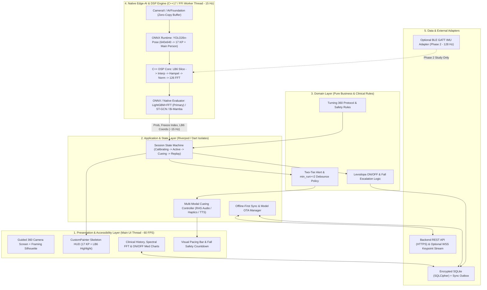

# Analisis Sistem, Spesifikasi Blueprint & Strategi Pengembangan Frontend — ParkinStep (Mobile-FOG)

> **Sumber Audit:** Repositori saudara `../FP-BIOMEDIC---Parkinson-Mobile-FOG`  
> **Target Repositori:** `Front-End-FP-Biomedic-ParkinStep`  
> **Tanggal Analisis:** 20 November 2026  

---

## 0. Ringkasan Eksekutif & Temuan Kunci

Berdasarkan audit menyeluruh terhadap seluruh kode, notebook pelatihan, skema dataset, checkpoint model, skrip visualisasi, dan dokumen referensi pada folder `FP-BIOMEDIC---Parkinson-Mobile-FOG`, ditemukan **tiga fakta arsitektural paling menentukan** untuk perancangan aplikasi frontend **ParkinStep**:

1. **Status Backend Saat Ini Adalah *Offline ML Research Pipeline* (Belum Ada Web/API Service Produksi)**  
   Repositori `FP-BIOMEDIC---Parkinson-Mobile-FOG` berisi dataset klinis (`Data/Train Val Test/`), notebook ekstraksi & prapemrosesan (`parkinsonfp-biomed.ipynb`), notebook pelatihan & evaluasi 4 model (`MobileFOG_Rhama_Training_4Models_Kaggle.ipynb`), bobot terlatih (`.pt` PyTorch & `.txt` LightGBM), skrip rendering demo (`render_pose_demo_videos.py`), dan materi presentasi. **Belum terdapat server backend produksi (REST API, WebSocket, database pasien, autentikasi)** maupun **artefak ekspor edge-mobile (ONNX, TFLite/LiteRT, CoreML)**. Artinya, pengembangan frontend harus berjalan paralel dengan kontrak integrasi *Edge-AI on-device* dan spesifikasi backend pendamping (*cloud sync/telemedicine*).

2. **Paradigma Modalitas Produksi: Kamera Smartphone Monokular (*Non-Wearable*), Bukan Sensor IMU Wajib**  
   Meskipun dataset memiliki file IMU 128 Hz (`SUBxx_y.txt`), pada arsitektur **Mobile-FOG** sensor IMU tulang kering **hanya berperan sebagai sumber label *ground truth* klinis (dan *wearable oracle baseline* Skenario F saat riset)**. Pada aplikasi mobile untuk pasien di rumah/puskesmas, input inferensi utama adalah **video kamera smartphone monokular (720p, diproses di 15 Hz atau 30 Hz)** yang merekam tungkai bawah selama protokol tes *360° Turning-in-Place* berdurasi ~2 menit.

3. **Rekomendasi Model & Frekuensi Produksi: `B_15hz` + `LightGBM+FFT` (Primary) & `Light_ST-GCN` / `Pure_Bi-Mamba` (Secondary)**  
   - **Frekuensi 15 Hz (`T=30` frame per jendela 2 detik)** terbukti lebih optimal untuk edge mobile dibanding 30 Hz (`T=60`): memangkas beban inferensi `YOLO26n-Pose` sebesar **50%**, menghasilkan skor `Test PR-AUC` dan `F1_pp` yang lebih konsisten pada hampir seluruh model, serta **meniadakan ketergantungan pada filter Butterworth 9 Hz non-kausal (`sosfiltfilt`)** yang di kode hanya aktif pada `fs >= 25.0`.
   - **`LightGBM+FFT` pada skenario `B_15hz`** (ukuran model hanya **193 KB**, 54 pohon, 126 fitur, `0 GB` VRAM) meraih **`Val PR-AUC` tertinggi (`0.5782`)**, **`Test F1_pp` tertinggi (`0.6390`)**, `Test ROC-AUC` `0.8672`, serta performa terkuat pada audit parsial **27/35-fold LOSO** (`F1_pp = 0.6843`, `Sensitivity = 75.23%`, `Specificity = 87.28%`, `Balanced Acc = 81.26%`).
   - **`Pure_Bi-Mamba` (`B_15hz`, 843 KB, 212.289 params)** meraih **`Test PR-AUC` tertinggi (`0.6631`)**, sedangkan **`Light_ST-GCN` (`181 KB`, 38.521–38.801 params)** paling ringan di kelas deep learning.

---

## 1. Ringkasan Analisis Sistem & Kebutuhan Frontend

### 1.1 Inventaris & Peta Komponen `FP-BIOMEDIC---Parkinson-Mobile-FOG`

| Komponen / File | Peran dalam Sistem | Temuan Teknis Kunci |
| :--- | :--- | :--- |
| `Data/DATASET_OVERVIEW_DAN_DESKRIPSI.pdf` | Dokumentasi dataset & pembagian eksperimen tim | Menjelaskan 35 subjek, 71 trial, skenario A–F, pembagian tugas Rhama (`YOLO26n-Pose`), Sultan (`DWPose-m` 133 kp), Faiz (`MediaPipe-Lite` 33 kp). |
| `Data/Train Val Test/{train,val,test}/` | Dataset mentah klinis (Ribeiro De Souza et al., *Frontiers in Neuroscience* 2022) | Terbagi subject-disjoint: `videos/*.mp4` (1280×720, ~29.98 fps), `imu_128hz/SUBxx_y.txt` (128 Hz), `labels_15hz/*.csv`, `labels_30hz/*.csv`. |
| `parkinsonfp-biomed.ipynb` | Pipeline Ekstraksi Pose & Preprocessing (Tahap 1–3) | Menjalankan `YOLO26n-pose.pt` (2× GPU T4), membangun Scenario A (7 kanal), Scenario B (9 kanal), dan Scenario D windowed tensor + `StandardScaler` fit-on-train. |
| `MobileFOG_Rhama_Training_4Models_Kaggle.ipynb` | Pipeline Training & Evaluasi 4 Model + 35-Fold LOSO | Melatih 4 model × 4 skenario (`A/B × 15/30 Hz` = 16 run) + post-processing `min_run=2` + worker LOSO (`_loso_worker.py`). |
| `output/yolo26n-pose.pt` | Bobot Pose Estimator | Ukuran **7.6 MB** (7.878.574 bytes), 17 COCO keypoints, NMS-free + RLE head. |
| `output/mobilefog_rhama/` | Artefak hasil ekstraksi pose & fitur windowed | Berisi `joint_schema.json`, `manifest_trials_local.csv`, `01_extracted_poses_raw/yolo26n_rhama/`, dan `02_processed_scenarios/{A,B,D}`. |
| `output training/mobilefog_training_results/` | Hasil benchmark & bobot model terlatih | Berisi `results_summary.csv`, `figures/rhama_4models_comparison.png`, 16 file checkpoint (`checkpoints/`), serta 27/35 fold hasil LOSO (`loso_35fold_B_15hz/fold_01..27.npz`). |
| `render_pose_demo_videos.py` & `demo_skeleton_videos/` | Prototipe Visualisasi HUD | Merender video skeleton 17 KP + highlight LB6 (Merah saat FoG, Hijau saat Normal) + bar HUD waktu, frame, & rata-rata confidence LB6. |
| `Presentasi_SMA/` & `REFERENSI/` | Konteks klinis, telemedicine & justifikasi arsitektur | Memuat konteks Indonesia (0,3 neurolog per 100.000 penduduk, skrining Karo, 70% adopsi telemedicine) serta paper referensi (Han et al. 2025, Li et al. 2022, Yan 2018, Ke 2017, Mamba 2023, YOLO26 2026). |

#### Konteks Dataset Klinis & Pembagian Split
- **Sumber Data:** Dataset publik Ribeiro De Souza et al. (*Frontiers in Neuroscience* 2022, Figshare `14984667`). Pasien Parkinson melakukan tes **berputar 360° di tempat secara bergantian kanan–kiri** selama ~2 menit di hadapan kamera smartphone setinggi tungkai bawah, didampingi asisten klinis.
- **Skala & Distribusi Label:** **35 subjek** (26 FoG aktif, 9 kontrol 0% FoG), **71 trial berlabel** (42 positif, 29 kontrol negatif), **173 episode FoG**, median durasi episode **2.94 detik**, proporsi frame FoG **18.92%**.
- **Split Ketat *Subject-Disjoint* (Anti-Data Leakage):**
  - **Train:** 23 subjek (`02, 03, 04, 05, 07, 11, 13, 14, 15, 17, 18, 19, 20, 21, 22, 26, 28, 29, 30, 31, 33, 34, 35`) = **47 trial** = **5.535 window** (~19.2% FoG). Indeks seimbang 1:1 (`balanced_train_idx`) = 2.126 window.
  - **Validation:** 5 subjek (`08, 09, 12, 25, 27`) = **10 trial** = **1.169 window** (~19.1–19.3% FoG). Digunakan untuk *early stopping* dan pencarian threshold F1 optimal.
  - **Test (Terkunci):** 7 subjek (`01, 06, 10, 16, 23, 24, 32`) = **14 trial** = **1.652 window** (~18.4–18.6% FoG).

> **Catatan Audit Repositori:** Hanya artefak eksperimen jalur **Rhama (`YOLO26n-Pose`)** yang lengkap kode dan checkpoint-nya di dalam repositori. Jalur **Sultan (`DWPose-m` 133 kp, 149.3 MB)** dan **Faiz (`MediaPipe-Lite` 33 kp, 5.8 MB)** tercantum di `DATASET_OVERVIEW_DAN_DESKRIPSI.pdf`, namun output/notebook-nya belum ada di repositori ini.

---

### 1.2 Alur Data End-to-End & Algoritma Deteksi FoG

Alur pemrosesan sinyal video menjadi prediksi FoG yang diimplementasikan pada `parkinsonfp-biomed.ipynb` dan `MobileFOG_Rhama_Training_4Models_Kaggle.ipynb` adalah sebagai berikut:

```mermaid
flowchart LR
    V["Video Kamera HP 720p (29.98 fps)"] --> DS["Subsampling (15 Hz / 30 Hz)"]
    DS --> Y["YOLO26n-Pose (640x640, det_conf=0.25)"]
    Y --> MP["Main-Person Selector (Area x Conf x Center Bias)"]
    MP --> LB6["Slice 6 Sendi LB6 (Hip, Knee, Ankle)"]
    LB6 --> INT["Interpolasi Linear (conf < 0.20)"]
    INT --> DEN["Scenario B: Hampel (w=7, s=3.0) + Butter 9Hz (fs>=25)"]
    DEN --> NORM["Normalisasi Pelvis & Leg Length + Turunan (dx, dy, ddx, ddy, bone)"]
    NORM --> WIN["Sliding Window 2.0s (T=30 @15Hz / T=60 @30Hz, Stride 1.0s)"]
    WIN -->|"X Raw (Unscaled)"| LGBM["LightGBM + 126 Fitur FFT/Kinematik"]
    WIN -->|"X_scaled (StandardScaler Train)"| DL["Light_ST-GCN / Pure_Bi-Mamba / Hybrid"]
    LGBM --> THR["Thresholding (thr_val dari Val)"]
    DL --> THR
    THR --> PP["Post-Processing Debounce (min_run >= 2 window)"]
    PP --> OUT["Status: Normal (0) vs FoG (1)"]
```



#### Detail Teknis Tiap Tahap Pipeline

1. **Stage 1 — Pose Estimation (`YOLO26n-Pose`):**
   - Resolusi input `imgsz=640`, ambang deteksi `det_conf=0.25`.
   - Menghasilkan 17 COCO keypoints `(x, y, conf)` per frame.
   - **Main-Person Selection (`_select_main_person`):** Karena pada video klinis sering tampak asisten/caregiver di sisi kanan/kiri pasien, pipeline memilih 1 orang utama dengan skor:
     $$\text{Score}_i = \text{Area}_i \times \text{Conf}_i \times \left(1.0 - 0.3 \cdot \frac{|c_{x,i} - W/2|}{\max(W/2, 1)}\right)$$
   - Frontend wajib mempertahankan logika seleksi ini agar gerakan caregiver/pendamping tidak terbaca sebagai sinyal pasien.

2. **Stage 2 — Prapemrosesan LB6 (`parkinsonfp-biomed.ipynb`):**
   - Mengambil 6 sendi tungkai bawah (`lb6_indices = [11, 12, 13, 14, 15, 16]`):
     `0: L_Hip`, `1: R_Hip`, `2: L_Knee`, `3: R_Knee`, `4: L_Ankle`, `5: R_Ankle`.
   - **Interpolasi:** Jika `conf < 0.20`, koordinat `(x, y)` diinterpolasi linear sepanjang sumbu waktu (`np.interp`); jika tidak ada satupun frame valid, diisi `0.0`.
   - **Denoising (khusus Scenario B):**
     - *Hampel rolling-median filter* (`window=7`, `n_sigma=3.0`, ambang MAD `3.0 * 1.4826 * MAD`) untuk menyingkirkan *outlier* lonjakan keypoint akibat oklusi putaran 360°.
     - Jika `fs >= 25.0`, diterapkan filter *Butterworth low-pass* orde-4 `cutoff=9.0 Hz` (`sosfiltfilt`) — sengaja di atas pita tremor FoG `3–8 Hz` dan di bawah batas Nyquist `15 Hz`.
   - **Normalisasi Invarian Posisi & Tinggi Badan (`normalize_lb6`):**
     - Pusat koordinat: `pelvis_center = median(0.5 * (L_Hip + R_Hip))` per trial.
     - Skala panjang kaki: `scale = median(0.5 * (leg_L + leg_R))`, di mana `leg = ||Hip - Knee|| + ||Knee - Ankle||`.
     - Vektor tulang (`bone_x, bone_y`): `Hip -> 0`, `Knee -> Hip`, `Ankle -> Knee`.
   - **Kanal Fitur Output:**
     - **Scenario A (7 kanal):** `[x, y, conf, dx, dy, bone_x, bone_y]`
     - **Scenario B (9 kanal):** `[x, y, conf, dx, dy, ddx, ddy, bone_x, bone_y]` (dengan `dx, dy, ddx, ddy` dihitung via `np.gradient`).

3. **Stage 3 — Sliding Window & Scaling (Scenario D):**
   - Ukuran jendela: `2.0 detik` (`T=30` frame @ 15 Hz, `T=60` frame @ 30 Hz), stride `1.0 detik` (overlap 50%, yakni `15` frame @ 15 Hz atau `30` frame @ 30 Hz).
   - Dimensi tensor per sampel: `(C, T, V)` yaitu `(9, 30, 6)` untuk `B_15hz`.
   - Label utama training: **`y_maj`** (bernilai `1` bila `>= 50%` frame dalam window berlabel FoG). Label lain yang tersedia di `.npz`: `y_any`, `y_ge25`, `y_ratio`.
   - Filter validitas IMU: membuang window yang memiliki `inside_imu_mask == 0` (karena pada 3 trial `01_2, 02_1, 10_2`, video 2.2–3.0 detik lebih panjang daripada rekaman IMU).
   - **StandardScaler:** Dihitung hanya pada `train` per kanal `(1, C, 1, 1)` dan disimpan ke `scaler_stats.npz`. Nilai aktual untuk `from_B_denoised_hampel_accel_15hz`:
     - `mean`: `[0.05256, 0.47850, 0.88466, -0.00002, -0.00001, -0.00001, 0.00000, 0.00343, 0.31831]`
     - `std` : `[0.32510, 0.40507, 0.26166, 0.07987, 0.01337, 0.05731, 0.00986, 0.14646, 0.23872]`

4. **Stage 4 — Arsitektur 4 Kandidat Classifier:**
   - **A. `LightGBM+FFT` (Input: `X` Raw *Unscaled*, Output: 126 Fitur Tabular):**
     Fungsi `extract_fft_kinematic_features(X_raw, fs)` mengekstrak **126 fitur** (terverifikasi dari `max_feature_idx=125` di `lgbm_B_15hz.txt`):
     - `72` fitur statistik dasar (`mean, std, max(|x|)`) pada 4 kanal `[x, y, dx, dy]` × 6 sendi.
     - `36` fitur spektral FFT pada kecepatan `[dx, dy]` × 6 sendi: PSD `|rfft(sig - mean)|^2` dibagi menjadi pita lokomotor (`0.5–3.0 Hz`, `e_loco`) dan pita freeze (`3.0–min(8.0, 0.49*fs) Hz`, `e_freeze`), lalu dihitung `log1p(e_loco)`, `log1p(e_freeze)`, dan **Moore's Freeze Index** `log1p(e_freeze / e_loco)`.
     - `12` fitur asimetri bilateral & jarak antar sendi untuk 3 pasangan `(L/R Hip, L/R Knee, L/R Ankle)`: `mean(dist_xy)`, `std(dist_xy)`, `mean(|dx_L-dx_R|+|dy_L-dy_R|)`, `std(asym_v)`.
     - `6` fitur rata-rata `confidence` per sendi.
   - **B. `LightweightSTGCN` (Input: `X_scaled`, 38.521–38.801 params, ~181 KB):**
     Menggunakan matriks ketetanggaan graf tulang `A_LB6` berdimensi `(3, 6, 6)` (*Root*, *Inward/Centripetal* `[(2,0),(3,1),(4,2),(5,3),(0,1)]`, *Outward/Centrifugal*), `BatchNorm1d`, 3 blok `STGCNBlock` (`32 -> 64 -> 64`) dengan *learnable* `edge_mask` dan konvolusi temporal *depthwise-separable* `9×1`, serta `GlobalAvgPool`.
   - **C. `PureBiMamba` (Input: `X_scaled`, 211.521–212.289 params, ~843 KB):**
     Stem `Linear(C*6 -> 64) + LayerNorm + SiLU`, diikuti 2 blok `BiMambaBlock` (`d_model=64, expand=2, d_state=16, d_conv=4`) dengan *Pure-PyTorch Selective SSM* dua arah (maju & mundur tanpa custom CUDA kernel), `RMSNorm`, dan temporal pooling.
   - **D. `HybridGCNBiMamba` (Input: `X_scaled`, 216.153–216.345 params, ~864 KB):**
     Dua layer `SpatialGraphConv` (`in_c -> 32 -> 64`), *joint mean pooling*, lalu 2 blok `BiMambaBlock`.

5. **Stage 5 — Post-Processing (`apply_min_duration_filter`):**
   - Menghapus deteksi FoG positif terisolasi (`run < 2` window berurutan). Dengan panjang window 2 detik dan stride 1 detik, sebuah episode baru terkonfirmasi secara klinis bila muncul minimal pada **2 window berurutan** (rentang ~3 detik sinyal).

#### Hasil Benchmark Model (`results_summary.csv` & Audit Parsial LOSO)

**A. Evaluasi Fixed Subject-Disjoint Split (Train 23 / Val 5 / Test 7 — 16 Run Lengkap):**

| Skenario | Model | Params / Trees | Ukuran File | Val PR-AUC | Test ROC-AUC | Test PR-AUC | Test F1 (Raw / PP) | Sens (PP) | Spec (PP) | Bal Acc (PP) | Thr (Val) |
| :--- | :--- | :---: | :---: | :---: | :---: | :---: | :---: | :---: | :---: | :---: | :---: |
| **`B_15hz`** | **`LightGBM+FFT`** | **54 trees** | **193 KB** | **0.5782** | **0.8672** | 0.6066 | **0.6086 / 0.6390** | 0.6026 | 0.9353 | 0.7690 | 0.26 |
| **`B_15hz`** | **`Pure_Bi-Mamba`** | 212.289 | 843 KB | 0.4176 | 0.7689 | **0.6631** | 0.5942 / 0.6124 | 0.5635 | **0.9368** | 0.7502 | 0.15 |
| `A_15hz` | `Pure_Bi-Mamba` | 211.521 | 840 KB | 0.4093 | 0.7659 | 0.6385 | 0.5540 / 0.5710 | 0.6352 | 0.8654 | 0.7503 | 0.15 |
| `A_15hz` | `LightGBM+FFT` | 52 trees | 186 KB | 0.5183 | 0.8602 | 0.6294 | 0.5747 / 0.5866 | 0.6124 | 0.8914 | 0.7519 | 0.22 |
| `B_30hz` | `LightGBM+FFT` | 72 trees | 254 KB | 0.5440 | **0.8715** | 0.6137 | 0.5686 / 0.5925 | **0.7270** | 0.8361 | **0.7815** | 0.16 |
| `A_15hz` | `Hybrid_GCN+BiMamba` | 216.153 | 863 KB | 0.4233 | 0.7514 | 0.6065 | 0.5133 / 0.5340 | 0.5505 | 0.8833 | 0.7169 | 0.17 |
| `A_15hz` | `Light_ST-GCN` | **38.521** | **181 KB** | 0.4064 | 0.8442 | 0.5756 | 0.5933 / 0.6053 | 0.5993 | 0.9130 | 0.7562 | 0.38 |
| `B_15hz` | `Light_ST-GCN` | 38.801 | 182 KB | 0.3990 | 0.8053 | 0.5730 | 0.5408 / 0.5615 | 0.4984 | 0.9368 | 0.7176 | 0.39 |
| `A_30hz` | `LightGBM+FFT` | 81 trees | 284 KB | 0.5313 | 0.8527 | 0.5676 | 0.5654 / 0.5812 | 0.6711 | 0.8561 | 0.7636 | 0.16 |
| `B_30hz` | `Hybrid_GCN+BiMamba` | 216.345 | 864 KB | 0.4481 | 0.7003 | 0.5453 | 0.4632 / 0.4753 | 0.4901 | 0.8709 | 0.6805 | 0.21 |
| `B_15hz` | `Hybrid_GCN+BiMamba` | 216.345 | 864 KB | 0.4132 | 0.7159 | 0.4849 | 0.4849 / 0.4969 | 0.6482 | 0.7807 | 0.7144 | 0.17 |
| `A_30hz` | `Light_ST-GCN` | 38.521 | 181 KB | 0.3545 | 0.7072 | 0.4383 | 0.3803 / 0.3700 | 0.2599 | 0.9674 | 0.6136 | 0.15 |

*(Model lain pada 30 Hz — `A_30hz Pure_Bi-Mamba` F1_pp 0.5801, `B_30hz Pure_Bi-Mamba` F1_pp 0.5424, `B_30hz Light_ST-GCN` F1_pp 0.3926, `A_30hz Hybrid` F1_pp 0.2703 — secara konsisten menunjukkan bahwa 30 Hz lebih rentan overfitting dibanding 15 Hz untuk arsitektur neural.)*

**B. Evaluasi Parsial 27/35-Fold LOSO (`loso_35fold_B_15hz`, subjek `01..27`, `N=6.355` window, FoG `22.17%`):**

| Model (Skenario `B_15hz`) | OOF ROC-AUC | OOF PR-AUC | OOF F1 (Raw / PP) | Sensitivity (PP) | Specificity (PP) | Balanced Acc (PP) |
| :--- | :---: | :---: | :---: | :---: | :---: | :---: |
| **`LightGBM+FFT`** | 0.7426 | 0.3730 | **0.6626 / 0.6843** | **0.7523** | **0.8728** | **0.8126** |
| `Light_ST-GCN` | 0.7716 | **0.4781** | 0.5571 / 0.5704 | 0.6558 | 0.8166 | 0.7362 |
| `Pure_Bi-Mamba` | **0.7758** | 0.4208 | 0.4651 / 0.4590 | 0.4564 | 0.8484 | 0.6524 |
| `Hybrid_GCN+BiMamba` | 0.7104 | 0.4557 | 0.3678 / 0.3655 | 0.3683 | 0.8156 | 0.5920 |

---

### 1.3 Gap Kritis & Tantangan Konversi *Offline-to-Mobile* (*Training-Serving Skew*)

Frontend engineer wajib memahami celah berikut sebelum mengimplementasikan pipeline inferensi di HP agar tidak terjadi degradasi akurasi (*training-serving skew*):

1. **Operasi Non-Kausal pada Prapemrosesan Offline vs Kebutuhan Streaming Real-Time:**
   - Di notebook, `pelvis_center` dan `scale` (`leg_length`) dihitung sebagai **median seluruh sesi 2 menit**, filter Hampel menggunakan `center=True` (membutuhkan **3 frame masa depan**, atau latensi `200 ms` @ 15 Hz), turunan memakai `np.gradient` (beda tengah/non-kausal), Butterworth `sosfiltfilt` bersifat *two-pass zero-phase*, dan `min_run=2` menunda konfirmasi selama ~3 detik.
   - **Solusi Arsitektural Frontend:** Implementasikan **2 mode inferensi**:
     - **Mode 1 — *Guided 2-Min Assessment* (Post-Session Batch / Sliding Replay):** Menjalankan pipeline identik 100% dengan notebook setelah rekaman 2 menit selesai (`atol < 1e-4`), untuk laporan klinis akurat ke dokter.
     - **Mode 2 — *Live Real-Time Monitoring & Cueing* (Causal Streaming):** Menggunakan fase **kalibrasi berdiri 3–5 detik** di awal untuk mengunci `pelvis_center` & `leg_length` (atau *running EMA* saat posisi kamera tetap), **ring buffer kausal 30 frame** dengan *lookahead* maksimal 3 frame (`200 ms`) untuk Hampel, turunan beda mundur/terpusat dalam buffer, serta **peringatan 2 tingkat (*Two-Tier Alert*)**: *Early Warning* pada 1 window positif (`>= thr`) dan *Confirmed FoG Cueing* pada `min_run >= 2`.
2. **Diskrepansi antara Presentasi & Implementasi Kode Aktual:**
   - Slide `Presentasi_SMA` menyebut "Anti-Swap Kaki kiri-kanan" dan parameter `PureBiMamba` `138K–203K`, namun pada kode aktual `parkinsonfp-biomed.ipynb` **fungsi koreksi swap kiri–kanan belum diimplementasikan**, dan jumlah parameter aktual `PureBiMamba` adalah **212.289** (`B_15hz`).
   - Proses 35-fold LOSO di folder `loso_35fold_B_15hz/` baru tersimpan **27 fold (`fold_01..27`)** — subjek `28..35` belum selesai/belum tersimpan.
   - Rekomendasi di slide masih menyebut `Hybrid GCN + Bi-Mamba` sebagai kandidat unggulan, padahal hasil empiris `results_summary.csv` & 27-fold LOSO membuktikan **`LightGBM+FFT` (terbaik F1/BalAcc/stabilitas LOSO)** dan **`Pure_Bi-Mamba` / `Light_ST-GCN`** jauh mengungguli `Hybrid`.
3. **Aturan Input Scaling yang Berbeda antar Model:**
   - `LightGBM+FFT` dilatih pada **`X` mentah (unscaled)**, sedangkan `Light_ST-GCN`, `Pure_Bi-Mamba`, dan `Hybrid` dilatih pada **`X_scaled` (`scaler_stats.npz`)**. Kesalahan menukar input ini akan merusak prediksi secara total.
4. **Keterbatasan Topologi 17 COCO KP & Kalibrasi Probabilitas:**
   - Keypoint COCO berhenti di pergelangan kaki (*ankle*), belum mencakup tumit/ujung jari kaki (baru dieksplorasi di skenario LB10 DWPose/MediaPipe). Selain itu, nilai probabilitas mentah `sigmoid` / `predict_proba` memiliki ambang optimal rendah (`thr = 0.15`–`0.39` akibat ketidakseimbangan kelas ~19% FoG), sehingga **UI tidak boleh menampilkan probabilitas mentah sebagai "persentase kepastian" sebelum dinormalisasi terhadap `thr_val`**.

---

### 1.4 Identifikasi Fitur Utama Aplikasi Mobile (`ParkinStep`)

Berdasarkan analisis sistem, aplikasi mobile **ParkinStep** harus mengakomodasi **6 pilar fitur utama**:

1. **Protokol Akuisisi Kamera & Kalibrasi Terpandu (*2-Min 360° Turning-in-Place*)**
   - Tampilan kamera dengan *framing guide silhouette* agar seluruh tungkai bawah pasien (`L/R Hip`, `L/R Knee`, `L/R Ankle`) masuk utuh ke frame pada jarak aman.
   - Pemilihan otomatis pasien utama (*Main-Person Lock* berbobot area + confidence + posisi tengah) agar caregiver yang mendampingi tidak ikut terdeteksi.
   - Indikator kualitas tangkapan *real-time*: pencahayaan, kestabilan FPS (`>= 15 FPS`), serta indikator `LB6 Confidence` (peringatan suara/visual otomatis bila `< 0.20`).
   - Tahap kalibrasi awal (*Quiet Standing* 3–5 detik) untuk mengambil referensi `leg_length` & `pelvis_center` sebelum instruksi suara memandu pasien berputar 360° kanan-kiri selama 120 detik.

2. **Engine Inferensi Edge-AI (*Offline-First*) & Opsi Cloud Fallback**
   - Seluruh pipeline **YOLO26n-Pose → LB6 Preprocessor → Classifier (`LightGBM+FFT` & opsional `Light_ST-GCN`/`Pure_Bi-Mamba`)** berjalan **100% lokal di perangkat (*offline-first*)** tanpa bergantung internet — krusial untuk skenario telemedicine di daerah pedesaan Indonesia.
   - Dukungan pemilihan model dinamis (*Primary: LightGBM+FFT 15Hz* untuk akurasi F1/kecepatan baterai terbaik; *Deep Verification / Post-Session Analysis* dengan `Pure_Bi-Mamba` atau `Light_ST-GCN`).
   - Opsi sinkronisasi asinkron atau *cloud fallback* (hanya mengirim koordinat skeleton LB6, atau video terenkripsi atas persetujuan pasien) untuk perangkat berdaya komputasi sangat rendah.

3. **Sistem *Cueing* Multi-Modal & Deteksi Keselamatan Jatuh**
   - **Two-Tier FoG Alert:**
     - *Tier 1 (Early Warning, 1 window >= `thr`):* Indikator kuning lembut + persiapan cue.
     - *Tier 2 (Confirmed FoG, `min_run >= 2` window berurutan):* Pemicuan intervensi otomatis.
   - **Auditory Cueing — *Rhythmic Auditory Stimulation (RAS)*:** Metronom ritmis adaptif (ketukan reguler 60–110 BPM) + instruksi suara tenang Bahasa Indonesia (*"Berhenti sejenak, tarik napas, angkat kaki mengikuti ketukan"*).
   - **Haptic & Visual Cueing:** Pola getar ritmis (terutama saat ponsel dipegang caregiver atau terhubung ke perangkat bantu) dan *high-contrast visual pacing bar* pada layar.
   - **Eskalasi Keamanan Jatuh (*Fall / Prolonged Freeze Guard*):** Jika episode FoG berlangsung melebihi ambang kritis (mis. `> 15 detik`) atau terdeteksi penurunan mendadak koordinat `y` pinggul (*hip vertical drop*) diikuti imobilitas, tampilkan dialog konfirmasi kondisi pasien (*"Apakah Anda baik-baik saja?"*) dengan hitungan mundur menuju notifikasi darurat caregiver/kontak keluarga.

4. **Visualisasi Real-Time HUD & Dashboard Riwayat Klinis / Telemedicine**
   - **Live Skeleton HUD:** Merender 17 sendi tubuh secara ringan dan menyorot **6 sendi LB6 dengan garis lebih tebal** (Hijau `#46D75F` saat *Normal Gait*, Merah `#F54137` saat *FoG*, meniru prototipe `render_pose_demo_videos.py`).
   - **Timeline Episode & Probabilitas FoG (0–120 detik):** Grafik interaktif yang menandai blok waktu terjadinya setiap episode FoG, total durasi freeze, median durasi episode, dan rasio `% waktu FoG`.
   - **Visualisasi Spektral Biomekanika (Equalizer 0.5–3 Hz vs 3–8 Hz):** Menampilkan perbandingan energi lokomotor normal vs energi gemetar FoG (*Moore's Freeze Index*) serta indikator **Asimetri Bilateral Kiri–Kanan** agar dokter & keluarga paham *mengapa* alarm aktif (*explainability*).
   - **Pelacakan Status Medikasi (*ON vs OFF Levodopa*):** Merujuk motivasi riset Han et al. (2025) di `REVIEW PAPER & RENCANA FP KELOMPOK 4.pdf`, setiap sesi mencatat status obat (*ON-Medication*, *OFF-Medication*, waktu minum obat terakhir) untuk memantau tren efektivitas terapi lintas minggu/bulan.
   - **Ekspor Laporan Klinis:** Generate laporan **PDF** terstruktur & **CSV** ringkasan sesi untuk dibagikan via WhatsApp/telemedicine ke dokter spesialis saraf.

5. **Aksesibilitas Pasien Parkinson (*Tremor-Resilient UX*) & Privasi Medis**
   - **Dual-Mode Interface:** *Mode Pasien/Lansia* (tombol raksasa `>= 56–64 dp`, kontras WCAG AAA, minimalisasi gestur *swipe/drag* yang sulit bagi penderita tremor, kontrol suara *hands-free* *"Mulai Tes"* / *"Berhenti"*) dan *Mode Caregiver / Klinisi* (akses analitik detail, kalibrasi, ekspor laporan).
   - **Privacy-Preserving Video Disposal:** Mode default yang langsung menghapus file `.mp4` mentah setelah ekstraksi skeleton selesai (atau tidak menyimpan video ke disk sama sekali pada mode live), sehingga privasi wajah/ruangan rumah pasien terlindungi.
   - **Medical Disclaimer Eksplisit:** Penegasan bahwa ParkinStep adalah alat bantu skrining & pemantauan dini, **bukan pengganti diagnosis atau resep dokter saraf**.

6. **Ekstensi Opsional Fase 2 — Integrasi Wearable IMU via BLE**
   - Bukan syarat MVP, namun arsitektur disiapkan agar di Fase 2 aplikasi dapat terhubung opsional ke sensor IMU 6-aksis eksternal via **Bluetooth Low Energy (BLE)** pada `128 Hz` (format `ACC/GYR ML, AP, SI`) untuk studi validasi klinis di rumah sakit maupun *sensor fusion* (Scenario F).

---

### 1.5 Identifikasi Skema Data Eksisting, Status API & Rancangan Protokol Komunikasi

#### A. Skema Data & Artefak Eksisting di `FP-BIOMEDIC---Parkinson-Mobile-FOG`

Data dan kontrak tensor berikut **sudah ada** di repositori backend riset dan wajib dipatuhi secara presisi oleh frontend:

1. **Skema Sendi (`output/mobilefog_rhama/01_extracted_poses_raw/joint_schema.json`):**
   - `estimator`: `"yolo26n-pose.pt"` (`num_keypoints: 17`, format COCO).
   - `lb6_indices`: `[11, 12, 13, 14, 15, 16]` -> `["L_Hip", "R_Hip", "L_Knee", "R_Knee", "L_Ankle", "R_Ankle"]`.
2. **Skema Pose Mentah Per Trial (`01_extracted_poses_raw/yolo26n_rhama/{split}/{trial_id}.npz`):**
   - `kps`: `float32[T, 17, 3]` `(x_px, y_px, conf)`
   - `boxes`: `float32[T, 4]` `(x1, y1, x2, y2)`
   - `valid`: `bool[T]`
   - `fps`: `float32` (`~29.98`), `W`: `int32` (`1280`), `H`: `int32` (`720`).
3. **Skema Label Tersinkronisasi (`Data/Train Val Test/{split}/labels_{15,30}hz/{trial_id}.csv`):**
   - Kolom: `frame_idx, time_s, y_fog, inside_imu_mask`.
4. **Skema IMU 128 Hz (`Data/Train Val Test/{split}/imu_128hz/SUBxx_y.txt`, TSV):**
   - Kolom: `Frame #`, `Time [s]`, `ACC ML [g]`, `ACC AP [g]`, `ACC SI [g]`, `GYR ML [deg/s]`, `GYR AP [deg/s]`, `GYR SI [deg/s]`, `Freezing event [flag]`.
5. **Skema Fitur Scenario B & Windowed Scenario D (`02_processed_scenarios/`):**
   - Per-frame (`B_denoised_hampel_accel/yolo26n_lb6_15hz`): `X` `float32[T, 6, 9]`, `y_fog` `int64[T]`, `inside_imu_mask` `int64[T]`.
   - Per-window (`D_windowed_stgcn_cls/from_B_denoised_hampel_accel_15hz`): `X` `float32[N, 9, 30, 6]` (untuk `LightGBM+FFT` → 126 fitur), `X_scaled` `float32[N, 9, 30, 6]` (untuk PyTorch models), `scaler_stats.npz` (`mean`, `std` shape `(1, 9, 1, 1)`).
6. **Skema Output Prediksi & Evaluasi (`_loso_worker.py` / `results_summary.csv`):**
   - Probabilitas per window `p` `float32`, ambang batas `thr_val` (`0.26` untuk `B_15hz LightGBM+FFT`, `0.15` untuk `B_15hz Pure_Bi-Mamba`, `0.39` untuk `B_15hz Light_ST-GCN`), hasil biner terfilter `min_run=2`.

#### B. Status Protokol Komunikasi Saat Ini
- **REST API / GraphQL / gRPC:** Belum ada di repositori `FP-BIOMEDIC---Parkinson-Mobile-FOG`.
- **WebSocket:** Belum ada.
- **BLE:** Belum ada (file IMU dibaca offline dari `.txt`).

#### C. Rancangan Protokol Komunikasi & Kontrak Endpoint yang Harus Dibangun

Untuk menghubungkan aplikasi mobile **ParkinStep** dengan ekosistem layanan backend telemedicine & pembaruan model (*Model Registry*), diperlukan **3 lapisan protokol komunikasi**:

| Lapisan Protokol | Arah & Kegunaan | Target Latensi / Payload | Keterangan Implementasi |
| :--- | :--- | :--- | :--- |
| **1. Native On-Device IPC / FFI (`C++ JSI` / `dart:ffi` / `JNI`)** | Kamera → `YOLO26n-Pose` → DSP LB6 → Classifier → HUD UI | **`< 66 ms/frame`** (@ 15 FPS), 0 KB jaringan | Jalur utama produksi! Berjalan pada background thread terpisah agar UI tetap 60 FPS. |
| **2. REST API (`HTTPS` + JSON, OpenAPI 3.1)** | Autentikasi, profil pasien & jadwal obat, sinkronisasi riwayat sesi, unduh OTA model & `scaler_stats`, laporan PDF, alert darurat | Async (`1–30 KB` per sesi skeleton; `< 1 MB` per download model) | Menggunakan skema **Offline-First Outbox**: data sesi disimpan terenkripsi lokal lebih dulu, lalu disinkronkan saat internet tersedia. |
| **3. WebSocket (`WSS` Opsional — *Cloud Fallback*)** | Streaming keypoint LB6 15 Hz ke server jika HP tidak kuat menjalankan classifier deep learning tertentu | **`~1.1 KB/s`** (15 Hz × ~72 bytes biner/JSON per frame) | Jauh lebih hemat bandwidth dibanding streaming video mentah; menjaga privasi pasien. |
| **4. BLE GATT (`Fase 2 Opsional`)** | Akuisisi IMU 6-aksis 128 Hz untuk studi validasi klinis RS | Characteristic Notify `~2.5–4 KB/s` | Memetakan karakteristik BLE ke struktur kolom `ACC/GYR ML, AP, SI` kompatibel Scenario F. |

**Daftar Endpoint REST API Target yang Harus Dikonsumsi Frontend:**

| Method & Endpoint | Fungsi Utama | Payload Inti (Request / Response) |
| :--- | :--- | :--- |
| `POST /api/v1/auth/login` & `/refresh` | Login pasien / caregiver / neurolog | JWT Access + Refresh Token, `role` (`PATIENT \| CAREGIVER \| CLINICIAN`) |
| `GET / PATCH /api/v1/patients/{patient_id}` | Profil pasien, tinggi badan referensi, kontak darurat | `patient_id`, `emergency_contacts`, `consent_flags` |
| `POST / GET /api/v1/patients/{id}/medications` | Catat jadwal & konsumsi obat (Levodopa ON/OFF tracking) | `drug_name`, `dosage_mg`, `taken_at_iso`, `med_state` (`ON \| OFF`) |
| `POST /api/v1/sessions` | Registrasi sesi tes baru (dengan *idempotency key* untuk offline sync) | `session_id` (UUIDv7), `protocol` (`TURNING_360_2MIN`), `fps` (`15`), `model_version`, `med_state`, `lighting_score` |
| `POST /api/v1/sessions/{id}/skeleton-frames` | Unggah batch keypoint LB6 terkompresi (opsional, bukan video mentah) | Chunked `t_ms[]`, `lb6_xyc[T, 6, 3]`, `is_valid[]` |
| `POST /api/v1/sessions/{id}/results` | Unggah hasil ringkasan & timeline episode FoG hasil inferensi on-device | `fog_percentage`, `episode_count`, `median_episode_s`, `window_probs[]`, `freeze_indices[]`, `episodes[]` |
| `POST /api/v1/sessions/{id}/analyze-video` | *(Fallback Cloud Opsional)* Unggah video terenkripsi jika on-device gagal | `multipart/form-data` + consent flag `auto_delete_after_inference=true` |
| `GET /api/v1/sessions/{id}/report?format=pdf\|json` | Unduh / bagikan laporan klinis untuk dokter saraf | Binary PDF atau JSON ringkasan klinis lengkap |
| `GET /api/v1/patients/{id}/analytics/trends` | Data grafik progresi jangka panjang & perbandingan ON vs OFF obat | Agregasi mingguan/bulanan `fog_pct`, `episode_count`, `freeze_index_avg` |
| `GET /api/v1/models/manifest` | Cek versi model edge, download URL ONNX, `scaler_stats`, dan `thr_val` | Lihat contoh payload JSON di bawah |
| `POST /api/v1/alerts/emergency` | Kirim notifikasi darurat ke caregiver saat jatuh / freeze > 15s | `patient_id`, `session_id`, `trigger_type`, `timestamp`, `approx_location` |

**Contoh Kontrak JSON `GET /api/v1/models/manifest` (Kunci Anti-Skew):**
```json
{
  "bundle_version": "2026.11-b15hz-v1",
  "target_fps": 15,
  "window_sec": 2.0,
  "stride_sec": 1.0,
  "min_run_windows": 2,
  "pose_estimator": {
    "name": "yolo26n-pose",
    "format": "onnx",
    "input_size": [1, 3, 640, 640],
    "det_conf": 0.25,
    "kp_conf_interp_thr": 0.20,
    "sha256": "<sha256-hash>"
  },
  "classifiers": {
    "primary": {
      "name": "LightGBM+FFT",
      "scenario": "B_15hz",
      "requires_scaled_input": false,
      "num_features": 126,
      "threshold_val": 0.26,
      "format": "onnx_or_treelite_or_lgbm_txt"
    },
    "secondary": {
      "name": "Light_ST-GCN",
      "scenario": "B_15hz",
      "requires_scaled_input": true,
      "scaler_mean": [0.05256, 0.47850, 0.88466, -0.00002, -0.00001, -0.00001, 0.0, 0.00343, 0.31831],
      "scaler_std": [0.32510, 0.40507, 0.26166, 0.07987, 0.01337, 0.05731, 0.00986, 0.14646, 0.23872],
      "threshold_val": 0.39,
      "format": "onnx"
    }
  }
}
```

---

## 2. Daftar Dokumen Spesifikasi Proyek (*Documentation Blueprint*)

Sebelum menulis kode aplikasi di `Front-End-FP-Biomedic-ParkinStep`, tim wajib menyusun dan menyepakati **9 dokumen spesifikasi** berikut secara berurutan agar *domain logic* biomedis, desain aksesibilitas Parkinson, dan kontrak ML tidak menyimpang selama pengembangan:

| Urutan | File Dokumen | Fokus Utama | Pemilik Utama |
| :---: | :--- | :--- | :--- |
| 1 | `docs/PRD.md` | Kebutuhan produk, persona pasien/caregiver/neurolog, ruang lingkup MVP vs Fase 2 | Product / Lead |
| 2 | `docs/DATA_PRIVACY_AND_CLINICAL_SAFETY.md` | Batasan medis, privasi video pasien (UU PDP), protokol eskalasi jatuh | Lead + Domain Biomedis |
| 3 | `docs/EDGE_ML_SPEC.md` | Ekspor ONNX, konversi DSP kausal, uji paritas numerik terhadap notebook | ML + Mobile Native Engineer |
| 4 | `docs/ARCHITECTURE.md` | Clean Architecture frontend, manajemen thread real-time (Camera/AI/UI) | Mobile Architect |
| 5 | `docs/API_CONTRACT.md` | Spesifikasi OpenAPI 3.1 REST, WebSocket keypoint stream, & BLE opsional | Frontend + Backend Engineer |
| 6 | `docs/LOCAL_STORAGE_AND_SYNC.md` | Skema SQLite terenkripsi, antrean offline outbox, resolusi konflik sync | Mobile Engineer |
| 7 | `docs/UI_UX_SPEC.md` | Design system ramah tremor, alur tes 360°, HUD skeleton & RAS cueing | UI/UX + Frontend Engineer |
| 8 | `docs/TESTING_AND_BENCHMARK_PLAN.md` | Golden-fixture parity test (14 video test), benchmark FPS/baterai/suhu | QA + Mobile Engineer |
| 9 | `AGENT_RULES.md` | Guardrail arsitektur, tipe data, keamanan & aturan kontribusi AI/Developer | Seluruh Tim |

### Rincian Tujuan & Poin Spesifik Tiap Dokumen

#### 1. `docs/PRD.md` (*Product Requirements Document*)
- **Tujuan Utama:** Menetapkan batas ruang lingkup produk **ParkinStep**, metrik keberhasilan klinis/teknis, serta memisahkan fitur MVP (video kamera tunggal 15 Hz on-device) dari fitur pasca-MVP (pairing BLE IMU, telekonsultasi sinkron).
- **Poin Spesifik yang Wajib Diisi:**
  - Persona & *User Journey* terpisah untuk: (a) **Pasien Parkinson / Lansia** (di rumah dengan keterbatasan motorik/tremor), (b) **Caregiver / Pendamping Keluarga** (perekam video 2 menit di lapangan/desa), dan (c) **Dokter Spesialis Saraf** (penerima laporan longitudinal ON/OFF obat).
  - *Functional Requirements* untuk 6 pilar fitur: Tes Terpandu *Turning 360°* 2 menit, Mode *Live Monitoring* vs *Post-Session Evaluation*, Cueing RAS Audio/Haptic/Visual, Log Medikasi Levodopa, Riwayat & Ekspor PDF/CSV, Mode Offline Penuh.
  - *Non-Functional Requirements* terukur: latensi pipeline `< 66 ms/frame` @ 15 FPS pada Android mid-range (RAM 4 GB, Snapdragon 6xx/7xx atau Helio G-series), waktu reaksi cueing `< 150 ms` pasca-konfirmasi window, ketahanan baterai minimal 5 sesi tes beruntun (`< 8%` drop per sesi 2 menit), ukuran aplikasi awal `< 45 MB`.
  - Matriks *In-Scope* vs *Out-of-Scope* (menegaskan aplikasi **bukan alat diagnosis otomatis**, melainkan alat skrining & *cueing* pendamping).

#### 2. `docs/ARCHITECTURE.md` (*Mobile Edge-AI & Clean Architecture Blueprint*)
- **Tujuan Utama:** Mendefinisikan batas lapisan arsitektur (*Domain – Data – Presentation – Native Inference Core*), alur *concurrency* multi-thread agar frame kamera tidak pernah memblokir UI 60 FPS, dan manajemen *state* sesi klinis.
- **Poin Spesifik yang Wajib Diisi:**
  - *Layer Dependency Diagram* berbasis Clean Architecture (`presentation/` -> `application/` -> `domain/` <- `infrastructure/` + `native_engine/`).
  - Desain *Concurrent Pipeline*: pemisahan **Camera Thread**, **Native Inference Worker (`YOLO26n-Pose` + DSP)**, **Ring-Buffer State Machine**, dan **Main UI Thread**, lengkap dengan kebijakan *frame-dropping / backpressure* saat CPU/NPU mengalami *thermal throttling*.
  - *Finite State Machine (FSM)* Sesi Tes: `IDLE -> FRAMING_CHECK -> CALIBRATING_STANDING (3-5s) -> RECORDING_ACTIVE (0..120s) -> [EARLY_WARNING | FOG_CONFIRMED_CUEING | FALL_ESCALATION] -> POST_SESSION_REPLAY -> COMPLETED`.
  - Manajemen *Lifecycle* OS: `WakeLock` agar layar tidak mati saat tes 2 menit, penanganan interupsi telepon masuk, pemulihan kamera setelah aplikasi di-minimize, serta izin OS (*Camera, Microphone opsional, Vibration, Notifications*).

#### 3. `docs/EDGE_ML_SPEC.md` (*Model Export, Causal DSP & Numerical Parity Specification*)
- **Tujuan Utama:** Menjadi "kitab hukum" integrasi model AI dari Python Kaggle ke runtime mobile, menjamin tidak ada *training-serving skew* antara kode notebook dan kode C++/Dart/Kotlin.
- **Poin Spesifik yang Wajib Diisi:**
  - Prosedur & konfigurasi ekspor model: `yolo26n-pose.pt` → `yolo26n-pose.onnx` (FP16/INT8 kalibrasi), `lgbm_B_15hz.txt` → `onnx` atau evaluator native C++, `stgcn_B_15hz.pt` & `bimamba_B_15hz.pt` → ONNX (`opset >= 17`, verifikasi kompatibilitas loop `SelectiveSSM1D` pada ONNX tracing!).
  - Spesifikasi eksak preprocessing kamera: konversi `YUV_420_888` / `BGRA` → `RGB`, *letterbox resize* ke `640×640` (padding `#727272`, normalisasi `/255.0`), dan decoding output *NMS-Free* YOLO26 (`1×N×(4+1+17*3)`).
  - Kontrak *Main-Person Selection* identik dengan `_yolo_extract_worker.py`.
  - Kontrak 2 varian DSP:
    - **Batch Exact DSP** (untuk mode *Post-Session*): `interpolate_low_conf(0.20)`, `hampel_filter_1d(w=7, sigma=3.0)`, `normalize_lb6(median pelvis, median leg_len)`, `np.gradient`, 126 fitur FFT (Moore's Freeze Index `0.5–3.0` vs `3.0–7.35 Hz` @ 15 Hz) pada **X raw unscaled**, serta `StandardScaler` (`mean`, `std` dari `scaler_stats.npz`) khusus model PyTorch.
    - **Causal Streaming DSP** (untuk mode *Live Cueing*): spesifikasi *3-5s standing calibration*, ring buffer `30` frame + lookahead 3 frame (`200 ms`), dan aturan konversi skor probabilitas mentah ke indeks kepercayaan UI menggunakan titik pivot `thr_val`.
  - Kontrak *Post-Processing*: `min_run=2` window berurutan, plus *hysteresis* untuk mengakhiri alarm cueing.

#### 4. `docs/API_CONTRACT.md` (*OpenAPI 3.1, WebSocket & BLE Contract*)
- **Tujuan Utama:** Menetapkan kontrak komunikasi formal antara aplikasi mobile dengan layanan backend (dan sensor BLE opsional) menggunakan skema tipe data yang *strict*.
- **Poin Spesifik yang Wajib Diisi:**
  - Spesifikasi OpenAPI 3.1 (YAML/JSON) untuk seluruh endpoint REST (`/auth/*`, `/patients/*`, `/medications`, `/sessions/*`, `/analytics/trends`, `/models/manifest`, `/alerts/emergency`).
  - Format pesan WebSocket `wss://.../ws/v1/stream/keypoints/{session_id}` (JSON/MessagePack per frame 15 Hz berisi `t_ms`, 6×3 array float32 LB6, dan frame ack/prediction balik).
  - Strategi *Idempotency-Key*, paginasi riwayat pasien, kode error terstandar (`422` validasi skema, `409` konflik sync, `429` rate limit), dan *Versioning* kompatibilitas antara versi app vs `bundle_version` model OTA.
  - Lampiran skema GATT BLE opsional (UUID Service/Characteristic untuk IMU 128 Hz 6-axis) untuk Fase 2.

#### 5. `docs/UI_UX_SPEC.md` (*Parkinson-Accessible Design System, Turning Protocol UX & Cueing*)
- **Tujuan Utama:** Memastikan antarmuka benar-benar dapat dioperasikan oleh pasien Parkinson (tremor tangan, bradikinesia, gangguan penglihatan lansia) dan caregiver non-medis di lapangan.
- **Poin Spesifik yang Wajib Diisi:**
  - **Ergonomi Motorik & Visual:** Ukuran target sentuh minimal **56–64 dp**, jarak antar tombol minimal `16 dp`, larangan gestur *swipe/pinch/double-tap* di alur utama pasien, kontras warna minimal `7:1` (WCAG AAA), ukuran font tubuh minimal `16–18 sp`, dukungan *Dynamic Type* & mode gelap/terang luar ruangan.
  - **Panduan Visual Framing Kamera 360°:** Ilustrasi siluet kaki di layar, indikator jarak ideal (2–3 meter), indikator warna hijau/kuning/merah untuk pencahayaan dan `LB6 Conf >= 0.20`, serta skrip *Text-to-Speech* Bahasa Indonesia untuk memandu tes 2 menit tanpa pasien/caregiver harus menatap layar terus-menerus.
  - **Spesifikasi Live Skeleton HUD:** Warna, ketebalan garis (upper body cyan tipis `2px`, LB6 hijau/merah tebal `4px`, titik putih ber-border seperti `render_pose_demo_videos.py`), badge status `NORMAL GAIT` vs `PERINGATAN DINI` vs `FREEZING OF GAIT`, serta animasi *visual pacing bar*.
  - **Desain Dashboard Klinis & Grafik:** Timeline 120 detik dengan *brush/zoom* episode, grafik bar *Freezing Index* (`0.5–3 Hz` vs `3–8 Hz`), kalender/tren keparahan **ON vs OFF Medikasi**, dan *wireframe* halaman PDF Laporan Neurolog.

#### 6. `docs/DATA_PRIVACY_AND_CLINICAL_SAFETY.md` (*Safety, Privacy & UU PDP Compliance*)
- **Tujuan Utama:** Mengelola risiko hukum, etika biomedis, dan keselamatan fisik pasien saat menggunakan aplikasi pemantauan kondisi neurodegeneratif.
- **Poin Spesifik yang Wajib Diisi:**
  - **Kepatuhan UU No. 27 Tahun 2022 (UU PDP Indonesia):** Persetujuan eksplisit (*granular opt-in*) terpisah untuk: (a) penyimpanan riwayat klinis lokal, (b) unggah koordinat skeleton anonim ke cloud dokter, dan (c) penyimpanan video sementara untuk audit.
  - **Kebijakan *Zero Raw-Video Retention*:** Mekanisme teknis penghapusan otomatis buffer video dari RAM/cache setelah sesi selesai apabila pasien memilih mode privasi penuh.
  - **Keselamatan Fisik Protokol 360° Turning:** Layar *pre-flight safety checklist* wajib sebelum tes dimulai (memastikan lantai tidak licin, tidak ada karpet terlipat/kabel, ruang putar bebas halangan, dianjurkan ada pendamping/pegangan kursi di dekat pasien).
  - **Protokol Eskalasi Darurat & False-Positive Guard:** Aturan pemicu pesan darurat (hanya jika freeze panjang `> 15s` atau indikasi jatuh dan tidak dibatalkan dalam `10 detik`), serta wording *Medical Disclaimer* baku di halaman onboarding, hasil tes, dan PDF ekspor.

#### 7. `docs/LOCAL_STORAGE_AND_SYNC.md` (*Offline-First Database & Sync Specification*)
- **Tujuan Utama:** Menjamin aplikasi bekerja mulus di wilayah minim jaringan (puskesmas/desa) tanpa kehilangan data klinis maupun kebocoran data sensitif di perangkat.
- **Poin Spesifik yang Wajib Diisi:**
  - Skema relasional database lokal terenkripsi (`SQLite + SQLCipher`): tabel `patients`, `medications`, `sessions`, `fog_episodes`, `window_predictions`, `skeleton_chunks`, `model_bundles`, dan `sync_outbox`.
  - Kebijakan retensi & kuota disk (mis. kompresi *delta-encoding* / `zlib` pada blob array skeleton `T×6×3` sehingga 1 sesi 2 menit 15 Hz hanya memakan `~50–100 KB`).
  - Mekanisme *Background Sync Worker*: retry *exponential backoff*, sinkronisasi khusus Wi-Fi untuk unduh bundle model ONNX baru, dan validasi integritas checksum `SHA-256` sebelum mengganti model aktif.

#### 8. `docs/TESTING_AND_BENCHMARK_PLAN.md` (*Verification, Parity & Device Profiling Plan*)
- **Tujuan Utama:** Menjamin hasil deteksi aplikasi mobile secara matematis identik dengan riset di notebook dan berjalan stabil tanpa *crash/overheating* di perangkat target.
- **Poin Spesifik yang Wajib Diisi:**
  - **Golden-Fixture Parity Suite:** Mengambil seluruh **14 video Test Set (`PDFE01_1..PDFE32_3`)** beserta output `.npz` & probabilitas `LightGBM+FFT` / `Light_ST-GCN` / `Pure_Bi-Mamba` dari repositori ML sebagai *golden test fixtures*. Syarat lulus: selisih output fitur 126 dimensi & probabilitas prediksi pada mode *Post-Session* harus `< 1e-4` (FP32) atau terukur degradasinya (< 1% PR-AUC) jika dikuantisasi FP16/INT8.
  - **Skenario Edge-Case Klinis:** Pengujian video dengan asisten klinis melintas di samping pasien (menguji `_select_main_person`), pencahayaan redup, pasien berputar membelakangi kamera (`conf < 0.20` -> interpolasi), dan 3 trial dengan panjang ekstra (`01_2, 02_1, 10_2`).
  - **Device Performance Matrix:** Profiling FPS aktual, penggunaan RAM puncak (`< 350 MB`), suhu baterai, dan *inference latency breakdown* (Camera Decode vs YOLO26 vs DSP vs Classifier) pada minimal 3 kelas HP (Entry Android 4 GB RAM, Mid-Range Android 6–8 GB RAM, iOS iPhone).

#### 9. `AGENT_RULES.md` (*Engineering & AI Agent Guardrails*)
- **Tujuan Utama:** Menetapkan aturan kode, batas arsitektur, dan pagar pengaman bagi developer manusia maupun *coding agent* agar kualitas dan integritas numerik proyek tetap terjaga selama pengembangan.
- **Poin Spesifik yang Wajib Diisi:**
  - **Aturan Integritas ML/Biomedis (Strict Invariants):** Larangan mengubah konstanta `LB6_INDICES`, `CONF_VALID_THRES = 0.20`, `HAMPEL_WINDOW = 7`, `HAMPEL_SIGMA = 3.0`, `scaler_stats`, `thr_val`, atau arah feeding `X` (raw untuk LightGBM vs scaled untuk PyTorch) tanpa memperbarui *Golden Parity Test* dan versi di `models/manifest`.
  - **Clean Architecture Boundaries:** Kode UI tidak boleh memanggil plugin kamera/ONNX secara langsung atau menyimpan logika matematika DSP; seluruh akses sensor/AI wajib melewati *interface* di domain layer.
  - **Type Safety & Security Rules:** Strict typing (Dart strong-mode / TypeScript `strict: true` / Kotlin explicit types), larangan *hardcoded API key/secret*, validasi skema runtime (Pydantic/JSON Schema di border API), dan *Conventional Commits*.

---

## 3. Tech Stack, Skills & Kompetensi Pengembangan Frontend

### 3.1 Analisis & Rekomendasi Tech Stack Mobile

Aplikasi **ParkinStep** memiliki beban teknis yang berbeda dari aplikasi CRUD mobile biasa karena harus melakukan **Computer Vision (`YOLO26n-Pose` @ 15 FPS)** + **Digital Signal Processing (`Hampel + FFT`)** + **Rendering Skeleton & Grafik Klinis 60 FPS** + **Audio Metronom Latensi Rendah** secara simultan.

#### Matriks Perbandingan Kandidat Tech Stack

| Dimensi Evaluasi | **Flutter (Dart + C++/FFI Core)** | **React Native (New Arch + VisionCamera v4 + Skia)** | **Kotlin Native (Android-First + CameraX + Compose)** |
| :--- | :--- | :--- | :--- |
| **Akses Frame Kamera Zero-Copy** | Baik (via Android CameraX / iOS AVFoundation Platform Channel langsung ke C++ JNI/Metal) | **Sangat Baik** (`react-native-vision-camera` v4 dengan JSI C++ Frame Processors tanpa serialisasi bridge JSON) | **Terbaik** (akses langsung `ImageAnalysis` YUV_420_888 NDK tanpa overhead cross-platform) |
| **Runtime Edge-AI (`YOLO26` + `ST-GCN`/`LGBM`)** | Baik via `dart:ffi` ke **ONNX Runtime Mobile C/C++ API** (lebih stabil daripada plugin Flutter komunitas) | Sangat Baik via `onnxruntime-react-native` (JSI) atau custom C++ TurboModule ke ONNX Runtime | **Terbaik** (native `onnxruntime-android` + akselerasi langsung NNAPI/QNN/Vulkan) |
| **DSP (`Hampel`, `FFT`, `126 Fitur`)** | **Sangat Baik** bila ditulis sebagai modul **C++17 (`dart:ffi` + KissFFT/PocketFFT)** — 100% deterministik & bisa dipakai ulang ke iOS/Android | **Sangat Baik** bila ditulis sebagai modul **C++17 JSI HostObject** — 100% portable | Sangat Baik di **C++ NDK (JNI)** atau Kotlin + JTransforms |
| **Visualisasi Skeleton HUD & Grafik Klinis** | **Sangat Baik** (`CustomPainter` di Impeller engine sangat mulus 60–120 FPS + `fl_chart`) | **Sangat Baik** (`@shopify/react-native-skia` render langsung ke GPU via Worklets + `victory-native`) | Sangat Baik (`Jetpack Compose Canvas` + `Vico` / `MPAndroidChart`) |
| **Jangkauan Platform (Android & iOS)** | **Android + iOS** dari 1 codebase UI + 1 codebase C++ DSP/AI | **Android + iOS** dari 1 codebase UI + 1 codebase C++ DSP/AI | **Android Only** (harus tulis ulang UI di SwiftUI jika butuh iOS) |
| **Stabilitas di HP Android Mid-Range Indonesia** | **Tinggi** (kompilasi AOT ARM64, tidak butuh JS engine untuk UI, ukuran ~25–35 MB + model) | Sedang–Tinggi (New Arch/Hermes sangat cepat, namun konfigurasi native JSI + Worklets lebih rentan konflik versi Gradle/RN) | **Tertinggi** (footprint RAM terkecil, debugging profiler Android Studio paling matang) |

#### Keputusan Rekomendasi Stack

1. **Rekomendasi Utama (*Best Cross-Platform Production Architecture*): `Flutter + Native C++17 / FFI Edge-AI Core`**
   - **Alasan Pemilihan:** Memberikan keseimbangan paling matang untuk konteks riset/produk di Indonesia (mayoritas pasien/puskesmas menggunakan Android mid-range, namun neurolog/keluarga juga banyak memakai iOS). Impeller rendering engine Flutter sangat kuat untuk menggambar skeleton HUD 60 FPS secara deterministik tanpa jitter JS garbage collection, sementara seluruh komputasi berat (**YUV→RGB letterbox, ONNX Runtime Mobile, Hampel, FFT 126-fitur, LightGBM tree evaluator**) diisolasi di **shared C++17 library via `dart:ffi`**.
   - **Alternatif Setara jika Tim Berlatar Belakang Web/TypeScript:** **React Native (New Architecture) + `react-native-vision-camera` v4 + `@shopify/react-native-skia` + C++ JSI Frame Processor**. Sangat unggul secara ergonomis untuk akses frame kamera langsung lewat Worklets, namun memerlukan disiplin tinggi mengelola versi native build (C++/CMake/Metro/Gradle).
   - **Alternatif Pragmatis (*Fastest MVP untuk Final Project Android-Only*):** **Kotlin Native (Jetpack Compose + CameraX + C++ NDK/JNI + ONNX Runtime)**. Dipilih **hanya jika** target resmi proyek ini 100% Android dan tenggat waktu sangat ketat, karena meminimalkan kerumitan *bridging* kamera-ke-ONNX dengan tetap mempertahankan modul C++ NDK yang portable.

#### Daftar Library & Tooling Spesifik yang Direkomendasikan (Untuk Stack Utama: Flutter + C++ FFI)

| Lapisan Sistem | Library / Teknologi Spesifik | Peran Teknis dalam ParkinStep |
| :--- | :--- | :--- |
| **Edge-AI Unified Runtime** | **ONNX Runtime Mobile (C/C++ API via FFI)** + `XNNPACK` / `NNAPI` / `CoreML` Execution Providers | Satu runtime tunggal untuk menjalankan **`yolo26n-pose.onnx`** dan **`light_stgcn.onnx` / `pure_bimamba.onnx` / `lgbm_b15hz.onnx`**. Mengapa ONNX Runtime? Karena mendukung operator graf/SSM sekaligus tree model (`LightGBM` via `onnxmltools`) secara konsisten. |
| **Camera Acquisition** | Platform Native **CameraX (`ImageAnalysis` YUV_420_888)** (Android) & **AVFoundation (`CVPixelBuffer`)** (iOS) -> pointer langsung ke C++ buffer | Menghindari copy frame melalui Dart channel! Hanya koordinat LB6 hasil inferensi (`~100 bytes/frame`) yang dikirim ke Dart Isolate UI. |
| **DSP & Numerical Math (C++17)** | **PocketFFT / KissFFT** + **Eigen** / pure C++17 STL | Implementasi kausal & batch untuk: interpolasi linear `conf < 0.20`, Hampel rolling median `w=7`, normalisasi pelvis/leg-length, turunan kecepatan/percepatan, ekstraksi 126 fitur FFT (Moore's Freeze Index), dan filter debounce `min_run=2`. |
| **Skeleton HUD & Grafik Klinis** | Flutter **`CustomPainter` (Impeller)** + **`fl_chart`** (atau **`Syncfusion Flutter Charts`**) | Menggambar kerangka 17 KP + LB6 merah/hijau di atas kamera preview secara *zero-jank*, serta grafik probabilitas timeline FoG & spektrum 0.5–8 Hz. |
| **Audio RAS Cueing & Haptics** | **`flutter_soloud`** (atau **Oboe C++ / AVAudioEngine**) + **`flutter_tts`** + **`vibration`** | Metronom RAS (*Rhythmic Auditory Stimulation*) wajib memakai audio engine latensi rendah (`< 20 ms` jitter), bukan pemutar audio UI biasa; dipadukan dengan TTS Bahasa Indonesia dan pola getar adaptif. |
| **State Management & DI** | **`flutter_riverpod`** (strict typed + codegen) + **`freezed`** | Mengelola FSM sesi tes, status ON/OFF medikasi, stream event FoG dari Isolate worker, dan dependency injection layer Clean Architecture. |
| **Local Encrypted DB & Sync** | **`drift` + `sqlcipher_flutter_libs`** + **`flutter_secure_storage`** + **`workmanager`** | Menyimpan riwayat sesi, episode, dan blob skeleton terkompresi secara terenkripsi AES-256 (*offline-first*), serta antrean background sync saat koneksi tersedia. |
| **Networking & Ekspor Klinis** | **`dio`** (+ `retrofit` / OpenAPI generator) + **`web_socket_channel`** + **`pdf` & `printing`** + **`csv`** | Klien API tipe-aman, WebSocket opsional keypoint stream, serta generator laporan klinis PDF siap cetak/kirim ke dokter saraf. |
| **Testing & Profiling** | **GoogleTest (C++ DSP parity tests)** + **`flutter_test`** + **Android Perfetto / Xcode Instruments** | Menguji paritas matematika C++ terhadap 14 trial test Python serta memantau *frame drop*, memori, dan suhu CPU/NPU. |

#### Arsitektur Internal Aplikasi Mobile (*Clean Architecture + Edge Pipeline*)



---

### 3.2 Rincian Skill Teknis & Domain yang Dibutuhkan Hingga Siap Produksi

Untuk membangun aplikasi **ParkinStep** dari nol hingga memenuhi standar kelayakan klinis dan operasional lapangan, tim pengembang harus menguasai **6 klaster kompetensi** berikut:

#### 1. *Computer Vision & Mobile Edge-AI Engineering*
- **Konversi & Kuantisasi Model:** Mengonversi `YOLO26n-pose.pt`, `stgcn_*.pt`, `bimamba_*.pt`, dan `lgbm_*.txt` ke format edge (ONNX/LiteRT); memahami verifikasi struktur graf ONNX (khususnya `SelectiveSSM1D` pada Bi-Mamba yang menggunakan loop sekuensial `for t in range(L)` di PyTorch).
- **Pre/Post-Processing Tensor Native:** Transformasi warna *YUV420 → RGB* berkecepatan tinggi, *letterbox padding* tanpa distorsi rasio aspek ke `640×640`, serta parsing output kepala *NMS-Free* + keypoint `(x, y, conf)` YOLO26.
- **Akselerasi Hardware & Manajemen Memori:** Konfigurasi *Execution Provider* (`NNAPI` / `QNN` / `XNNPACK` pada Android; `CoreML` / `Metal` pada iOS), deteksi fallback ke CPU bila NPU driver bermasalah di chipset tertentu, serta pencegahan *memory leak* / *thermal throttling* selama rekaman kontinu 2 menit.

#### 2. *Biomedical Signal Processing (DSP) & Gait Biomechanics*
- **Pemahaman Domain Klinis Parkinson & FoG:** Memahami perbedaan pola jalan normal (`0.5–3.0 Hz`) vs gemetar/kaki membeku FoG (`3.0–8.0 Hz`), keterbatasan *Teorema Nyquist* pada 15 Hz vs 30 Hz, anatomi kinematika tungkai bawah (**LB6**: `Hip, Knee, Ankle`), dan fenomena asimetri bilateral kiri–kanan.
- **Implementasi Algoritma Sinyal Deterministik:** Mampu menulis ulang fungsi Python (`interpolate_low_conf`, *Hampel rolling median + MAD*, normalisasi *pelvis-centered & leg-length scaled*, vektor tulang, turunan numerik, `rfft` + *Power Spectral Density* + *Moore's Freeze Index*) ke C++ secara presisi (**uji paritas `atol < 1e-4`**).
- **Desain Filter Kausal (*Streaming* vs *Batch*):** Memahami cara menjembatani perbedaan antara `np.median` global dan `center=True` di riset offline dengan *calibration phase* dan *causal ring buffer* pada aplikasi live tanpa mengorbankan sensitivitas deteksi.

#### 3. *Real-Time Concurrency, State Management & Offline-First Architecture*
- **Arsitektur Multi-Thread Anti-Jank:** Memisahkan thread akuisisi kamera, thread inferensi C++/FFI, dan main thread UI (Dart Isolates / JSI Worklets / Kotlin Coroutines), menerapkan strategi *drop-frame* bila antrean inferensi penuh (*backpressure control*).
- **State Machine Kompleks:** Mengelola transisi state sesi klinis, kalibrasi, peringatan dua tingkat (*Early Warning* vs *Confirmed FoG*), *cooldown/hysteresis* alarm cueing, dan interupsi sistem operasi.
- **Resilience Jaringan & Penyimpanan Lokal:** Desain skema database SQLCipher terenkripsi, pola *Transactional Outbox* untuk sinkronisasi tertunda di daerah pedesaan, serta manajemen pembaruan model *Over-the-Air* (OTA) dengan validasi checksum `SHA-256`.

#### 4. *Clinical Visualization, Accessibility UX & Multi-Modal Cueing Engineering*
- **Canvas Rendering 60 FPS:** Menggambar overlay skeleton 17 titik dan highlight LB6 secara responsif dan tepat skala terhadap resolusi preview kamera (menangani rotasi sensor kamera portrait/landscape dan *aspect-ratio crop*).
- **Visualisasi Data Medis:** Merancang grafik interaktif timeline episode FoG, spektrum frekuensi 0.5–8 Hz yang mudah dipahami dokter maupun keluarga, serta laporan ekspor PDF/CSV yang informatif.
- **Audio Engine Latensi Rendah & Ergonomi Lansia/Parkinson:** Membangun mesin metronom RAS yang stabil ritmenya (`< 20 ms` jitter), integrasi *Text-to-Speech* & *Voice Trigger*, serta penerapan pedoman aksesibilitas motorik tremor (*large hit targets, high contrast, zero precision-drag*).

#### 5. *API Integration, Cybersecurity & Medical Data Privacy (UU PDP)*
- **Integrasi Backend & Skema Tipe-Aman:** Implementasi klien OpenAPI 3.1, mekanisme *JWT token rotation*, *idempotency keys*, serta WebSocket streaming keypoint berbobot ringan.
- **Keamanan & Privasi Kesehatan:** Penerapan *certificate pinning* (TLS), penyimpanan token di Keystore/Keychain (`flutter_secure_storage`), kebijakan *zero hardcoded secrets*, anonimisasi & minimisasi data (mengirim keypoint tanpa video mentah), serta implementasi alur persetujuan pasien (*informed consent*) dan *auto-purge video* sesuai prinsip perlindungan data pribadi sensitif kesehatan.

#### 6. *Verification, Clinical QA & Mobile DevOps*
- **Automated Numerical Parity Testing:** Membangun *test harness* otomatis yang membandingkan output C++/Mobile terhadap **14 video test set (`PDFE01..32`)** dan mengaudit metrik regresi (`F1`, `PR-AUC`, `Sensitivity`, `Specificity`) sebelum rilis.
- **Device & Field Profiling:** Pengujian lapangan dengan variasi pencahayaan ruangan, keberadaan pendamping di frame, sudut kamera meleset, serta pemantauan metrik performa (FPS, CPU/RAM/thermal, crashlytics) melalui pipeline CI/CD mobile (*Fastlane / GitHub Actions*).

---

## Lampiran Ringkas: Peta Langkah Awal di Repositori `Front-End-FP-Biomedic-ParkinStep`

1. **Minggu 1 (Fondasi Spesifikasi & Ekspor Model):** Finalisasi `docs/PRD.md`, `docs/EDGE_ML_SPEC.md`, `AGENT_RULES.md`, serta skrip konversi + validasi paritas ONNX untuk `yolo26n-pose.pt`, `lgbm_B_15hz.txt`, dan `stgcn_B_15hz.pt` / `bimamba_B_15hz.pt` di repo ML.
2. **Minggu 2 (C++ Edge-AI & DSP Core + Parity Test):** Bangun modul C++17 (ONNX Runtime + LB6 DSP + 126 fitur FFT) dan buktikan paritas numerik terhadap `14` trial test set `FP-BIOMEDIC---Parkinson-Mobile-FOG`.
3. **Minggu 3 (App Shell, Camera Framing & Live Skeleton HUD):** Implementasikan *Clean Architecture* Flutter/Native, kamera 15 FPS zero-copy ke C++, dan overlay skeleton LB6 real-time.
4. **Minggu 4 (RAS Cueing, Offline DB, Riwayat & Laporan PDF):** Integrasikan *Two-Tier Cueing* (audio metronom/suara + haptic), log ON/OFF medikasi, penyimpanan terenkripsi SQLCipher, dan ekspor laporan klinis + pengujian pada perangkat Android mid-range.
