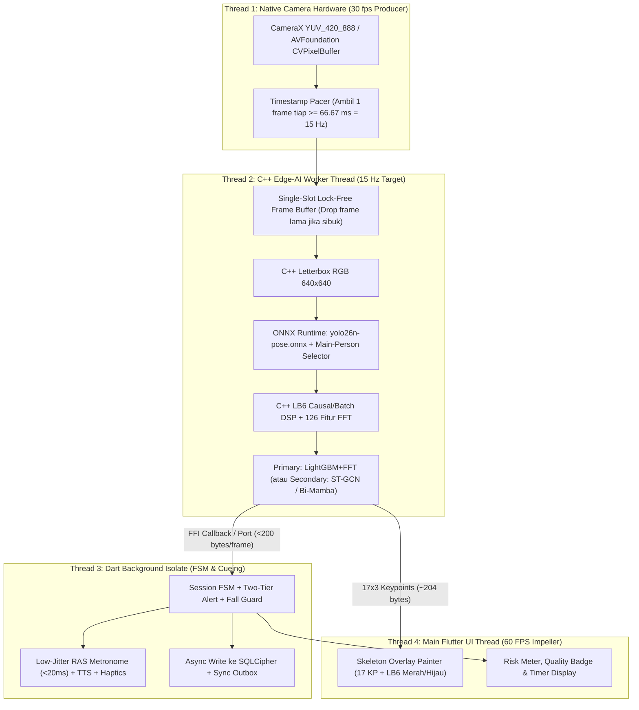
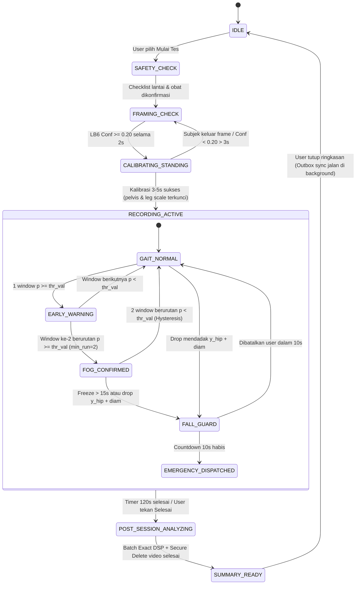

# Arsitektur Aplikasi Mobile & Concurrency Blueprint — ParkinStep

> **Status Dokumen:** Blueprint Arsitektur Implementasi (v1.0)  
> **Tanggal:** 2026-11-20  
> **Pola Arsitektur:** Clean Architecture + Domain-Driven Design (DDD) + Native C++17 Edge-AI Core  
> **Catatan UI/UX:** Detail widget visual dan layout layar pada [UI_UX_SPEC.md](./UI_UX_SPEC.md) **`[TBD — Dalam tahap riset desain oleh tim]`**; dokumen ini hanya mendefinisikan batas modul, kontrak data, *state machine*, dan *threading*.

---

## 1. Keputusan Stack Teknis & Justifikasi

| Komponen | Pilihan Arsitektur | Alasan Teknis |
| :--- | :--- | :--- |
| **Framework UI & App Shell** | **Flutter (Dart Strong-Mode)** | Rendering engine *Impeller* menjamin menggambar skeleton HUD 60–120 FPS tanpa *jank*; kompilasi AOT ARM64 stabil di Android mid-range Indonesia dan mendukung iOS dari 1 codebase. |
| **Native Edge-AI & DSP Core** | **C++17 Library via `dart:ffi`** (`native/parkinstep_core/`) | Seluruh pemrosesan YUV→RGB, *letterbox 640×640*, ONNX Runtime, Hampel, FFT 126 fitur, dan LightGBM dieksekusi *zero-copy* di C++ tanpa beban serialisasi Dart/Platform Channel per frame. Portabel ke NDK/iOS. |
| **Inference Engine** | **ONNX Runtime Mobile (C/C++ API)** | Satu runtime terpadu untuk `yolo26n-pose.onnx`, `lgbm_b15hz.onnx` (atau evaluator C++), `stgcn_b15hz.onnx`, dan `bimamba_b15hz.onnx` dengan backend `XNNPACK` / `NNAPI` / `CoreML`. |
| **Camera Hardware Access** | Native **CameraX** (Android) & **AVFoundation** (iOS) -> pointer buffer langsung ke C++ | Menghindari copy byte array gambar mentah melintasi bridge Flutter. |
| **State Management & DI** | **Riverpod (`flutter_riverpod`)** + **`freezed`** | *Compile-time dependency injection*, manajemen FSM sesi klinis yang deterministik, dan *immutable state*. |
| **Local Encrypted Storage** | **Drift (SQLite) + SQLCipher (AES-256)** | Penyimpanan riwayat klinis *offline-first* terenkripsi dengan antrean *outbox*. |
| **Low-Latency Audio RAS** | **`flutter_soloud`** (atau **Oboe C++**) + **`flutter_tts`** | Menjaga jitter metronom RAS `< 20 ms` agar ritme langkah pasien tidak terganggu lag audio UI standar. |

---

## 2. Clean Architecture & Struktur Direktori Target

Seluruh kode Dart/Flutter mengikuti **The Dependency Rule**: ketergantungan kode sumber **HANYA boleh mengarah ke dalam (*inward*)** menuju `domain/`. Layer `domain/` wajib 100% bebas dari import `flutter`, `dart:ffi`, `drift`, atau `dio`.

```text
Front-End-FP-Biomedic-ParkinStep/
├── docs/                                  # Dokumen spesifikasi teknis
├── native/
│   └── parkinstep_core/                   # C++17 Shared Edge-AI & DSP Engine
│       ├── CMakeLists.txt
│       ├── include/
│       │   ├── parkinstep_c_api.h         # Kontrak C-ABI untuk dart:ffi
│       │   ├── dsp_constants.hpp          # Konstanta terkunci (LB6, Hampel, FFT bins)
│       │   └── ring_buffer.hpp
│       ├── src/
│       │   ├── yuv_letterbox.cpp          # YUV420/BGRA -> RGB 640x640 NCHW
│       │   ├── yolo26_decoder.cpp         # NMS-Free decode + _select_main_person
│       │   ├── lb6_preprocessor.cpp       # Batch Exact & Causal Streaming DSP
│       │   ├── fft_features_126.cpp       # 126 fitur identik extract_fft_kinematic_features
│       │   ├── ort_runner.cpp             # Wrapper ONNX Runtime Mobile (Pose + DL)
│       │   └── post_processor.cpp         # Threshold + min_run=2 debounce
│       └── tests/                         # GoogleTest Golden Parity Suite (14 test trials)
├── lib/
│   ├── domain/                            # LAYER 1 (Innermost): Pure Dart, ZERO dependencies
│   │   ├── entities/                      # Patient, ClinicalSession, FogEpisode, MedicationLog
│   │   ├── value_objects/                 # Lb6Keypoints, FreezeMetrics, CalibratedRiskScore
│   │   ├── enums/                         # SessionMode, MedicationState, AlertTier
│   │   └── errors/                        # DomainFailures
│   ├── application/                       # LAYER 2: Ports, Use Cases, FSM Controllers
│   │   ├── ports/                         # Abstract interfaces (repositories, gateways)
│   │   │   ├── edge_inference_port.dart
│   │   │   ├── session_repository_port.dart
│   │   │   ├── cueing_port.dart
│   │   │   ├── emergency_alert_port.dart
│   │   │   └── sync_gateway_port.dart
│   │   ├── use_cases/                     # StartGuidedSession, EvaluatePostSession, ExportPdfReport
│   │   ├── state_machines/                # ClinicalSessionFsm, FallGuardTracker
│   │   └── dtos/                          # Freezed DTOs lintas boundary
│   ├── infrastructure/                    # LAYER 3: Adapters & Concrete Implementations
│   │   ├── edge_ai/                       # FFI bindings ke libparkinstep_core + Isolate worker
│   │   ├── camera/                        # Platform channel bridge ke CameraX / AVFoundation
│   │   ├── persistence/                   # Drift + SQLCipher DAOs & repository impls
│   │   ├── network/                       # Dio REST client, WSS fallback client, OTA updater
│   │   ├── cueing/                        # SoLoud metronome, TTS Bahasa Indonesia, Haptic impl
│   │   ├── export/                        # Generator PDF & CSV
│   │   └── security/                      # Keystore/Keychain wrapper, Video Secure Deleter
│   ├── presentation/                      # LAYER 4: UI Widgets, Painters (spec di UI_UX_SPEC.md)
│   └── di/                                # Composition Root (Riverpod Providers & Env Config)
├── android/                               # CameraX + CMake NDK + Keystore config
├── ios/                                   # AVFoundation + CMake XCFramework + Keychain config
└── test/                                  # Unit, FSM, Widget, dan Integration tests
```

---

## 3. Arsitektur *Concurrency* & Alur Pipeline Real-Time

Untuk mencegah UI mengalami *frame drop* saat menjalankan `YOLO26n-Pose` dan FFT di HP kelas menengah, pemrosesan dipisah ke dalam **4 domain eksekusi paralel** dengan kebijakan **Single-Slot Latest-Frame Drop (*Backpressure Control*)**:



### Kebijakan *Backpressure* & *Thermal Guard*
- **Single-Slot Queue:** Jika `YOLO26n-Pose` pada frame ke-`k` masih berjalan ketika frame ke-`k+1` (interval 15 Hz) tiba, frame baru **menimpa slot tunggu** alih-alih menumpuk antrean (mencegah lonjakan RAM dan latensi cueing yang makin molor).
- **Timestamp Actual Tracking:** Setiap frame yang lolos ke C++ membawa timestamp monotonik perangkat (`t_capture_ns`) agar perhitungan kecepatan/FFT dan deteksi drop FPS aktual tercatat akurat (`effective_fps`).
- **Thermal Degradation Policy:** Jika rata-rata durasi inferensi per frame melampaui `90 ms` selama `> 5 detik` berturut-turut (indikasi *thermal throttling* CPU/NPU), aplikasi otomatis beralih menampilkan peringatan lembut dan memprioritaskan penyimpanan keypoint ringan untuk evaluasi *Post-Session* tanpa memaksa inferensi classifier deep learning di background.

---

## 4. Finite State Machine (FSM) Sesi Tes 360°



### Penanganan Interupsi Sistem Operasi
- **Screen WakeLock:** Diaktifkan sejak `FRAMING_CHECK` hingga `SUMMARY_READY` dan otomatis dilepas pada `dispose` / `onPause`.
- **Interupsi Panggilan Masuk / App Backgrounded (`AppLifecycleState.paused`):** Sesi rekaman otomatis di-pause, mikrofon/kamera dilepas bersih sesuai aturan OS, metronom RAS dihentikan, dan state sementara disimpan aman agar tidak terjadi *corrupt buffer* saat pengguna kembali ke aplikasi.

---

## 5. Boundary Integrasi antar Lapisan

1. **Boundary `domain/` ↔ `application/`:** Seluruh entitas memakai tipe nilai eksplisit (`Lb6Keypoints`, `Duration`, `DateTime` dalam **UTC**). Tidak ada tipe `dynamic` atau map mentah JSON.
2. **Boundary `application/` ↔ `native/parkinstep_core` (`EdgeInferencePort`):**
   - `Future<void> loadModelBundle(ModelBundleConfig config)` — memuat model ONNX & array `scaler_mean` / `scaler_std` / `thr_val` dari manifest aktif.
   - `Stream<LiveFrameResult> startLiveStream(SessionCalibration calib)` — menerima stream frame hasil inferensi 15 Hz yang ringan (`kps_17x3`, `lb6_conf_avg`, `window_prob`, `alert_tier`, `freeze_index`).
   - `Future<PostSessionBatchResult> analyzeRecordedKeypoints(Float32List rawKps17x3, int frameCount)` — menjalankan *Mode A Batch Exact DSP* untuk hasil akhir klinis yang identik dengan notebook riset.
3. **Boundary `infrastructure/security/`:** Pembungkus `VideoDisposalService` wajib dipanggil pada blok `finally` setiap akhir `POST_SESSION_ANALYZING` maupun saat startup app untuk menyapu bersih file sementara yang tertinggal jika sebelumnya aplikasi mengalami *force close*.
