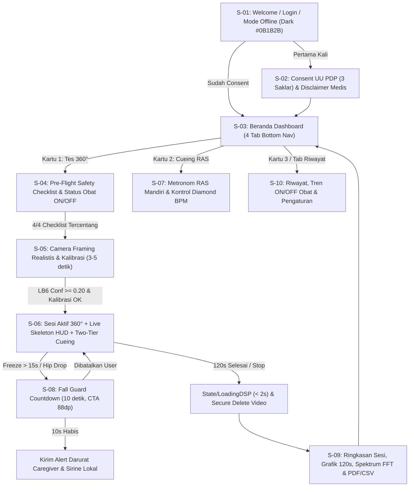

# Spesifikasi UI/UX & Sistem Desain Aksesibel: ParkinStep (Mobile-FOG)

> **Status Dokumen:** Spesifikasi Aktif Implementasi UI/UX (v2.0 Anti-Slop Overhaul)  
> **Tanggal:** 2026-11-20  
> **Arah Desain & Dial:** [DESIGN.md](./DESIGN.md) (`ENERGY 2 / RHYTHM 2 / MOTION 2`)  
> **Referensi Desain Utama:** 5 tangkapan layar aplikasi **Beats Medical** di folder [contoh/](../contoh/) + Audit v1 di [audit-001-2026-11-20.md](../anti-slop/audit-001-2026-11-20.md)  
> **Identitas Brand Terpilih:** Konsep A (`P+S` Kinetic Stride) pada [parkinstep_concept_a_icon.png](../assets/branding/concepts/parkinstep_concept_a_icon.png) & [brand_visual_dna.md](../.agents/skills/parkinstep-logo-designer/references/brand_visual_dna.md)  
> **Keterkaitan Teknis:** Memenuhi kebutuhan [PRD.md](./PRD.md), FSM di [ARCHITECTURE.md](./ARCHITECTURE.md), skor terkalibrasi di [EDGE_ML_SPEC.md](./EDGE_ML_SPEC.md), serta pagar keselamatan di [DATA_PRIVACY_AND_CLINICAL_SAFETY.md](./DATA_PRIVACY_AND_CLINICAL_SAFETY.md).

---

## 1. Prinsip Desain & Pemetaan Referensi `contoh/` (Beats Medical ke ParkinStep)

Antarmuka **ParkinStep v2** memadukan kejernihan visual ramah lansia dari **Beats Medical** (`contoh/`) dengan disiplin kerajinan `anti-slop` (WCAG 2.1 terhitung, target sentuh besar anti-tremor, hierarki satu titik fokus per layar, tanpa hiasan atau copy generik AI):

| File Referensi di `contoh/` | Pola Visual & Komponen Referensi | Adaptasi Kontekstual di **ParkinStep v2** |
| :--- | :--- | :--- |
| `WhatsApp Image 2026-11-20 at 16.10.35.jpeg` | **Dark Onboarding / Auth:** Latar gelap `#0B1B2B`, logo transparan kiri atas, tombol `?` bulat kanan atas, sapaan putih besar, tombol CTA biru penuh dengan lencana lingkaran putih kiri, garis `"OR"`, tombol sekunder soft-ice dua baris di zona ibu jari. | **S-01 (Welcome, Login & Mode Offline):** Kanvas `#0B1B2B`, lockup transparan Konsep A di kiri atas, tombol `?` suara kanan atas, spacer fleksibel agar blok aksi duduk pas di paruh bawah layar, CTA utama `#0077B6` (`4.87:1` AA) **Masuk dengan Akun**, pemisah `"ATAU"`, dan opsi `#D8F1FC` **Gunakan Mode Offline Lokal**. |
| `WhatsApp Image 2026-11-20 at 16.10.42.jpeg` | **Light Home Dashboard:** Header lockup + garis vertikal + sapaan 2 warna + perisai kanan; **3 kartu vertikal biru** berisi ubin putih miring dengan **3 ilustrasi garis berbeda**; pil metrik bergradien es dengan ikon kiri + angka kanan besar bertumpuk; kartu pengingat `#234085` (`Dismiss` vs `Start >`); carousel warna-warni (`Mint / Sky / Azure`) dengan cincin putih mengintip di bawah; 4 tab bottom nav. | **S-03 (Beranda ParkinStep):** Header berpemisah hairline vertikal + lockup Konsep A + `"Selamat Pagi, Pak Budi"` + perisai Privasi; 3 kartu `#0077B6` (`Tes 360°`, `Cueing RAS`, `Catat Obat`) dengan **3 ilustrasi medis line-art unik** di ubin miring (`-5° / +3.5° / -5°`); pil metrik `84 dp` (`2,4% FoG` / `Sesi terakhir • ON Obat`); banner `#234085` (`Lewati` & `Mulai >`); carousel 3 kartu warna bervariasi lengkap dengan cincin progres mengintip dari tepi bawah; bottom nav **`BERANDA \| RIWAYAT \| BANTUAN \| PENGATURAN`**. |
| `WhatsApp Image 2026-11-20 at 16.10.40.jpeg` | **Circular Pulse Timer & Diamond Steppers:** Cincin luar `#1AEAD8` + lingkaran dalam biru, timer besar (`10:00`), **2 tombol belah ketupat `45°` `#234085`** berbayang (`v` / `^`), 2 kolom metrik besar, tombol `Start` lebar di bawah. | **S-07 (Metronom RAS Mandiri):** Cincin ganda `#1AEAD8` (glow terarah tunggal) + `#0077B6`, angka tabular `02:00`, sepasang tombol **diamond `45°` `#234085` `64×64 dp`** (`v` / `^`) tanpa slider tipis, 2 metrik besar berpemisah hairline vertikal (`160 Estimasi Langkah` \| `80 BPM Metronom`), serta `Mulai Metronom` di zona ibu jari. |
| `WhatsApp Image 2026-11-20 at 16.10.40 (1).jpeg` | **Tick-Marked Semicircle Gauge & Highlighted Prompt:** Busur gradasi kuning-hijau bertanda skala `30..90` & jarum `#234085`, teks prompt bersorotan blok `#1AEAD8`, kapsul progres berborder navy. | **S-06 (Live 360° Session HUD):** Busur gauge setengah lingkaran bertanda tick & angka (`0, 25, 50, 75, 100`) memetakan **Skor Risiko FoG `0–100%`** (`50% = thr_val`), kartu instruksi putih dengan sorotan `#1AEAD8` (*`ANGKAT LUTUT ikuti ketukan`*), dan `ParkinProgressPill` `0–120 detik` di atas tombol akhiri sesi. |
| `WhatsApp Image 2026-11-20 at 16.10.40 (2).jpeg` | **Stacked Azure Pill List:** Judul Royal Navy `#234085`, subjudul tenang, tumpukan 5 tombol pil dengan ikon lingkaran putih berbeda di sisi kiri. | **S-04 (Pre-Flight Safety Checklist):** 4 baris checklist keselamatan (`ParkinStackedMenuTile` `64 dp` dengan **4 ikon berbeda** untuk kondisi lantai, ruang 1,5 m, kursi/pendamping, dan framing kamera), pemilih status obat `ON / OFF / Tidak Tahu`, dan tombol `Lanjut ke Kamera` di bagian bawah. |

> **Aturan Identitas Brand:** Seluruh logo, emblem, dan ilustrasi memakai bahasa visual **ParkinStep Konsep A (`P+S`)** dan **DILARANG** menampilkan teks/logo `BM`, `"Beats Medical"`, `"Nine Hole Peg"`, `"AI Powered"`, atau emoji dekoratif mentah di antarmuka.

---

## 2. Design Tokens (Terverifikasi WCAG 2.1 & Anti-Slop R-25/R-29)

Seluruh pasangan warna teks dan latar diverifikasi menggunakan `contrast-check.py` sebelum dipakai ke Flutter (`lib/presentation/theme/`) maupun Figma.

### 2.1 Sistem Warna Inti, Permukaan & Semantik Klinis

| Token Dart (`AppColors`) | Nama Variabel Figma | HEX | Rasio Kontras Terverifikasi | Aturan Penggunaan Ketat |
| :--- | :--- | :---: | :---: | :--- |
| `midnightNavy` | `bg/dark-canvas` | `#0B1B2B` | `17.41:1` vs `#FFFFFF` (**AAA**) | Kanvas Onboarding (`S-01`), viewport kamera (`S-05/06`), dan layar darurat (`S-08`). |
| `darkElevated` | `bg/dark-elevated` | `#13263B` | `14.50:1` vs `#FFFFFF` (**AAA**) | Panel HUD bawah terangkat (`S-06`) dan permukaan kartu di atas tema gelap. |
| `royalNavy` | `brand/royal-navy` | `#234085` | `9.80:1` vs `#FFFFFF` (**AAA**) | Judul layar terang, tombol diamond stepper `45°`, banner pengingat gelap, jarum gauge, PDF. |
| `clinicalAzure` | `brand/clinical-azure` | `#0077B6` | `4.87:1` vs `#FFFFFF` (**AA**) | **Latar utama tombol CTA, kartu fitur beranda, dan item checklist terpilih** yang memuat teks `#FFFFFF`. |
| `vibrantAzure` | `brand/vibrant-azure` | `#00A9EC` | `6.54:1` vs `#0B1B2B` (**AA**) | **Hanya untuk ikon non-teks, garis aksen, poros jarum gauge, dan `"Step"` di atas `#0B1B2B`. Dilarang sebagai latar/warna teks kecil di `#FFFFFF`!** |
| `onIceAzure` | `text/on-ice-azure` | `#006299` | `5.58:1` vs `#D8F1FC` (**AA**) | Teks link, judul tombol sekunder, dan kata aksi di atas `#D8F1FC` atau `#FFFFFF` (`6.40:1`). |
| `rhythmAqua` | `brand/rhythm-aqua` | `#1AEAD8` | `11.45:1` vs `#0B1B2B` (**AAA**), `6.44:1` vs `#234085` | **Aksen tunggal terarah:** cincin pulse metronom, isi bar progres, highlight kata perintah, dan kartu carousel Mint. |
| `softIce` | `surface/soft-ice` | `#D8F1FC` | - | Tombol aksi sekunder, gradien pil metrik, latar kartu consent opt-in nonaktif. |
| `iceSurface` | `surface/ice-tint` | `#E8F7FC` | - | Latar badge ikon kanan atas (`?`, perisai, suara) & tile checklist belum tercentang. |
| `skyCard` | `surface/sky-card` | `#BAE6FD` | `7.38:1` vs `#234085` (**AAA**) | Kartu kedua carousel riwayat di beranda dan border checklist belum dicentang. |
| `pureWhite` | `bg/pure-white` | `#FFFFFF` | `17.41:1` vs `#0B1B2B` | Kanvas utama beranda/metronom, ubin ilustrasi kartu, teks di atas `#0077B6`/`#234085`. |
| `slateCanvas` | `bg/light-canvas` | `#F8FAFC` | - | Latar scaffold halaman formulir, analitik & riwayat (`S-02`, `S-09`, `S-10`). |
| `subtleBorderLight` | `border/subtle-light` | `#E2E8F0` | - | Garis tepi `1 dp` kartu putih, pembagi vertikal header, garis grid chart. |
| `subtleBorderDark` | `border/subtle-dark` | `#1F3852` | - | Garis pemisah tipis di latar `#0B1B2B` (`S-01`). |
| `mutedSlate` | `text/secondary-light` | `#475569` | `7.58:1` vs `#FFFFFF` (**AAA**) | Teks subjudul/deskripsi di atas latar terang maupun `#D8F1FC` (`6.46:1`). |
| `mutedNavSlate` | `text/muted-nav` | `#64748B` | `4.76:1` vs `#FFFFFF` (**AA**) | Label bottom navigation nonaktif dan angka sumbu X/Y grafik. |
| `darkMuted` | `text/secondary-dark` | `#CBD5E1` | `11.73:1` vs `#0B1B2B` (**AAA**) | Teks penjelas di atas latar gelap `#0B1B2B`. |

#### Token Semantik Klinis & Skeleton HUD
| Token Semantik | Nilai HEX | Kontras & Peran Klinis |
| :--- | :---: | :--- |
| `normalEmerald` | `#22D399` | `8.99:1` vs `#0B1B2B` (**AAA**). Status `NORMAL GAIT`, tulang **LB6** aman, zona kiri gauge, tombol hijau darurat `"Saya Baik-Baik Saja"`, lencana teks `#065F46` di atas `#D1FAE5` (`6.78:1`). |
| `warningAmber` | `#F59E0B` / `#B45309` | `8.11:1` vs `#0B1B2B`; teks `#B45309` di atas putih (`5.02:1` **AA**); kotak disclaimer `#FFFBEB` / border `#FDE68A` / teks `#92400E` (`6.84:1` **AAA**). |
| `alertRed` | `#DC2626` | `4.83:1` vs `#FFFFFF` (**AA**). Status `KAKI MEMBEKU (FoG)`, tulang **LB6** membeku, ring Fall Guard `S-08`, batang FFT `3–7,35 Hz`, tombol `Selesaikan Tes`, teks `#991B1B` di `#FEF2F2` (`7.60:1`). |
| `upperBodySky` | `#38BDF8` | Garis kerangka tubuh bagian atas (`0..10`) di overlay kamera (`2 dp`, opacity `80%`). |

### 2.2 Skala Tipografi (`Plus Jakarta Sans` + Tabular Numerals)
- **Keluarga Font Utama:** `Plus Jakarta Sans` (utama) atau `Nunito` (cadangan). **Dilarang** memakai `Inter` atau monospace besar dekoratif. Timer, BPM, FPS, dan persentase FoG wajib menggunakan `FontFeature.tabularFigures()`.
- **Aturan Ukuran & Tracking:**

| Token Tipografi | Ukuran & Berat | Letter Spacing | Line Height | Penggunaan |
| :--- | :---: | :---: | :---: | :--- |
| `displayTimer` | `48–56 sp` ExtraBold | `-2%` | `1.05` | Timer 120 detik, angka BPM metronom, hitung mundur 10s Fall Guard. |
| `heroMetric` | `28–34 sp` Bold/ExtraBold | `-2%` | `1.15` | Angka metrik utama (`2,4% FoG`, `18,5%`, `160 Langkah`). |
| `screenTitle` | `24–28 sp` ExtraBold | `-2%` | `1.20` | Judul layar (`"Selamat Datang"`, `"Pilih untuk Memulai"`, `"Ringkasan Sesi"`). |
| `cardTitle` | `18–20 sp` Bold | `-1%` | `1.25` | Judul kartu, subbagian, header dialog. |
| `buttonLabel` | `16–18 sp` Bold | `0%` | `1.20` | Label tombol pil primer/sekunder & stacked tiles. |
| `bodyLarge` | `15–16 sp` Regular/Medium | `0%` | `1.45` | Paragraf pasien & Medical Disclaimer (tidak pernah `< 13 sp` untuk bodi). |
| `captionBadge` | `12–13 sp` SemiBold | `0%` | `1.30` | Label bottom nav (`12 sp` penuh tanpa pemotongan), angka sumbu grafik, timestamp. |

### 2.3 Spasi, Radius & Elevasi Selektif (`anti-slop` R-11/R-12/R-13)
- **Grid Dasar:** Kelipatan `8 dp`; padding horizontal halaman `20 dp`; celah antar elemen sentuh minimal `12–16 dp`.
- **Hierarki Radius (R-11):** Kartu utama & banner gelap `20–22 dp`; tombol pil & inner illustration tile `18 dp`; kotak info & status card `16 dp`; tombol diamond `45°` `16 dp`; bar progres & chip `999 dp`. **Dilarang** menyamaratakan semua elemen menjadi kapsul `999 dp`.
- **Elevasi & Glow Selektif (R-12, R-13):**
  - `Shadow/AzureCTA`: `0 10 24` (`#0077B6` 28%) **hanya** pada tombol CTA primer & 3 kartu fitur beranda agar elevasi menandakan kontrol aksi utama.
  - `Shadow/CardSubtle`: `0 4 14` (`#0B1B2B` 6%) pada kartu putih prompt/analitik di kanvas `#F8FAFC`.
  - `Glow/RhythmAqua`: `0 0 24` (`#1AEAD8` 24%) **hanya** pada cincin luar `ParkinPulseMetronomeRing`.

---

## 3. Standar Aksesibilitas Pasien Parkinson & Ketahanan Status (`anti-slop` R-03, R-27, R-39)

1. **Target Sentuh Raksasa:** Tombol ikon header `>= 44–48 dp` (area sentuh `>= 56 dp` di Flutter), tombol CTA primer & stacked tiles `>= 64 dp`, tombol pembatal Fall Guard (`"Saya Baik-Baik Saja"`) **`>= 84–88 dp`**.
2. **Bebas Gestur Presisi Tinggi & Em Dash:** Zero thin slider, zero horizontal swipe wajib, dan **nol karakter em dash (`—`)** di seluruh teks UI.
3. **3 Status Wajib per Tampilan Data (`antislop` R-27):**
   - **Empty State (`State/EmptyHistory`):** Menjelaskan alasan belum ada riwayat dan menyediakan tombol langsung **`"Mulai Tes Pertama"`**.
   - **Loading State (`State/LoadingDSP`):** Menjelaskan progres pemrosesan (*`"Menganalisis 120 detik gerak kaki..."`*) serta kepastian bahwa video sementara otomatis dihapus.
   - **Error State (`State/ErrorLowLight`):** Menjelaskan akar masalah (*`"Kaki kurang terlihat di kamera"`*), instruksi perbaikan konkret (nyalakan lampu / atur jarak `2–3 m`), dan tombol **`"Coba Kalibrasi Ulang"`**.

---

## 4. Peta Navigasi & Alur Layar (10 Layar MVP)

---

## 5. Katalog Komponen UI Standar (`lib/presentation/widgets/design_system/`)

1. **`ParkinPrimaryPillButton`** *(Ref `16.10.35`, `16.10.40`):* Tinggi `64 dp`, latar `#0077B6`, radius `18 dp`, `Shadow/AzureCTA`, lingkaran putih `46×46 dp` di kiri berisi ikon kontekstual `#0077B6`, label `#FFFFFF` `17–18 sp` Bold rata tengah.
2. **`ParkinSecondaryIceButton`** *(Ref `16.10.35`):* Tinggi `64 dp`, latar `#D8F1FC`, radius `18 dp`, lingkaran putih `46×46 dp` di kiri berisi ikon `#006299`, judul `#006299` `16 sp` Bold + subjudul `#475569` `13 sp`.
3. **`ParkinVerticalFeatureCard`** *(Ref `16.10.42`):* 3 kartu berdampingan (`108×158 dp` pada viewport 390), latar `#0077B6`, radius `20 dp`, `Shadow/AzureCTA`, ubin putih `82×82 dp` (`radius 18 dp`, rotasi `-5° / +3.5° / -5°`) berisi 3 ilustrasi line-art unik, label `#FFFFFF` `15 sp` Bold.
4. **`ParkinStackedMenuTile`** *(Ref `16.10.40 (2)`):* Tinggi `64 dp`, gap `12 dp`, varian tercentang (`#0077B6`, teks putih, centang kanan) & belum dicentang (`#E8F7FC`, border `1 dp #BAE6FD`, teks `#234085`), ikon kontekstual berbeda tiap baris di lingkaran putih kiri.
5. **`ParkinConsentToggleCard`:** Tinggi `76 dp`, latar `#FFFFFF`, border `1 dp #E2E8F0`, radius `16 dp`, saklar fisik `56×32 dp` (`#0077B6` ON vs `#CBD5E1` OFF).
6. **`ParkinMetricPill`** *(Ref `16.10.42`):* Tinggi `84 dp`, gradien lembut `#EBF8FE -> #D8F1FC`, border `1 dp #CBEAFB`, lingkaran ikon sepatu kiri `52×52 dp`, angka hero kanan `28 sp` ExtraBold `#234085` + sublabel `13 sp` `#475569`.
7. **`ParkinDarkReminderCard`** *(Ref `16.10.42`):* Latar `#234085`, radius `22 dp`, pertanyaan klinis jelas, tombol outline `Lewati` berdampingan dengan `Mulai` `#0077B6` yang membawa lingkaran panah putih kanan.
8. **`ParkinSessionCarouselCard`** *(Ref `16.10.42`):* 3 varian warna (`Mint #1AEAD8`, `Sky #BAE6FD`, `Azure #0077B6`), `108×132 dp`, `clipsContent = true`, menampilkan tanggal, badge `ON/OFF`, dan cincin progres putih+warna mengintip di tepi bawah.
9. **`ParkinPulseMetronomeRing`** *(Ref `16.10.40`):* Ring luar `#1AEAD8` (`272 dp`, `Glow/RhythmAqua`) + lingkaran dalam `#0077B6` (`228 dp`), timer tabular `52 sp`, dan **2 tombol diamond `45°` `#234085` `64×64 dp`** (`Shadow/DiamondControl`) dengan ikon chevron putih tegak `v` / `^`.
10. **`ParkinRiskGauge` & `ParkinHighlightPrompt` & `ParkinProgressPill`** *(Ref `16.10.40 (1)`):* Gauge setengah lingkaran `150°` bertanda 5 skala (`0..100`) & jarum tumpul `#234085` + `#00A9EC`; prompt putih dengan highlight `#1AEAD8` di belakang teks `#234085`; bar progres kapsul `24 dp` berborder `2 dp #234085`.

---

## 6. Blueprint 10 Layar MVP (`S-01` s.d. `S-10`) & Status Data (`State/*`)

Ringkasan lengkap 10 layar pada kanvas `390 × 844 dp` (dengan `System/StatusBar` dan `System/HomeIndicator` konsisten):
- **`S-01` Welcome & Login / Mode Offline (`#0B1B2B`):** Lockup transparan kiri atas, tombol `?` kanan atas, headline `"Selamat Datang"` + penjelas privasi, flex spacer ke zona ibu jari, CTA `"Masuk dengan Akun"` (`#0077B6`), jaminan kamera lokal, pemisah `"ATAU"`, CTA `"Gunakan Mode Offline Lokal"` (`#D8F1FC`).
- **`S-02` Consent UU PDP (`#F8FAFC`):** Judul `"Privasi & Keselamatan"`, kotak `"Perhatian Medis"` (`#FFFBEB`/`#FDE68A`) berisi disclaimer baku dari `DATA_PRIVACY_AND_CLINICAL_SAFETY.md`, 3 kartu toggle granular terpisah (`Analisis Kamera Lokal`, `Bagikan Ringkasan ke Dokter`, `Simpan Rekaman Audit Sementara`), dan CTA `"Setuju & Lanjutkan"` di bawah.
- **`S-03` Beranda Dashboard (`#FFFFFF`):** Header Beats-Medical, 3 kartu fitur (`Tes 360°`, `Cueing RAS`, `Catat Obat`) berilustrasi unik, `ParkinMetricPill`, `ParkinDarkReminderCard`, `ParkinSessionCarouselCard` 3 kartu (`20 Nov / 19 Nov / 18 Nov` data simulasi berlabel jelas), `ParkinBottomNav` (`BERANDA | RIWAYAT | BANTUAN | PENGATURAN`).
- **`S-04` Pre-Flight Safety Checklist (`#FFFFFF`):** `< Kembali`, 4 baris `ParkinStackedMenuTile` berikon berbeda (3 tercentang + 1 belum), pemilih status obat `ON / OFF / Tidak Tahu` bertombol lebar `56 dp`, CTA `"Lanjut ke Kamera (3/4)"`.
- **`S-05` Camera Framing & Kalibrasi Realistis:** Preview kamera ruang tamu terang dengan scrim atas/bawah untuk kontras HUD, pil status `Sendi LB6 96%` & `Cahaya Baik`, retikel pembidik `#1AEAD8`, kerangka `17 KP + LB6` hijau `#22D399` menempel tepat pada posisi sendi tubuh nyata, serta kartu kalibrasi frosted bawah (`3 dtk` hitung mundur).
- **`S-06` Sesi Aktif 360° & Two-Tier Cueing (`#0B1B2B` + `#13263B`):** Viewport kamera hidup bagian atas (`410 dp`) dengan status `00:58 / 02:00`, pil `#DC2626` `KAKI MEMBEKU`, kerangka LB6 merah menempel pada tungkai, disusul panel klinis bawah berisikan `ParkinHighlightPrompt`, `ParkinRiskGauge` bertanda skala pada `78%`, `ParkinProgressPill`, dan CTA `#DC2626` `64 dp` `"Selesaikan Tes"`.
- **`S-07` Metronom RAS Mandiri (`#FFFFFF`):** `< Kembali` + ikon `?` & suara, `ParkinPulseMetronomeRing` dengan dua kontrol diamond `45°`, label panduan tepi bawah cincin, statistik `160 Estimasi Langkah | 80 BPM Metronom`, dan `"Mulai Metronom"` di bagian bawah.
- **`S-08` Fall & Prolonged Freeze Guard (`#0B1B2B`):** Label tenang `"Perlindungan Keselamatan Aktif"` (tanpa badge eyebrow merah), cincin denyut merah konsentrasi dengan angka tabular `10 detik`, judul jelas `"Apakah Anda baik-baik saja?"`, penjelasan singkat, tombol raksasa **`88 dp` `#22D399` `"Saya Baik-Baik Saja"`**, serta tautan darurat sekunder.
- **`S-09` Ringkasan Hasil Sesi & Ekspor (`#F8FAFC`):** Subjudul berlabel *Data Simulasi • ON Obat*, 3 kartu metrik (kartu waktu FoG disorot merah lembut), Grafik 1 (*Kapan kaki membeku 0–120 dtk?*) dengan sumbu X/Y, garis kisi, ambang `50%`, 3 blok episode, dan kurva berisian gradien, Grafik 2 (*Energi langkah normal vs getaran FoG (FFT)*) beserta `Freeze Index: 2,41` & `Asimetri: Tinggi`, serta 2 tombol `Bagikan PDF ke Dokter` & `Ekspor CSV (118 Window)`.
- **`S-10` Riwayat & Tren Obat (`#F8FAFC`):** Judul `"Riwayat & Tren Obat"` + filter `"7 Hari"`, grafik dua seri (`● ON Obat` biru vs `■ OFF Obat` amber) lengkap dengan sumbu & garis kisi, daftar 3 sesi terbaru, metadata model `LightGBM+FFT v2026.11` (bebas jargon buzzword), dan `ParkinBottomNav` (`RIWAYAT` aktif).

---

## 7. Matriks *Live Skeleton HUD*, Grafik & Kualitas Sebelum Rilis

Seluruh aturan rendering `CustomPainter`, matriks respons `Two-Tier Cueing` (`GAIT_NORMAL`, `EARLY_WARNING`, `FOG_CONFIRMED`, `FALL_GUARD`), serta tata letak laporan A4 PDF (`parkinstep_mono_clinical.svg`) tetap mengacu pada [EDGE_ML_SPEC.md](./EDGE_ML_SPEC.md) dan [DATA_PRIVACY_AND_CLINICAL_SAFETY.md](./DATA_PRIVACY_AND_CLINICAL_SAFETY.md).

### Checklist Gerbang Kualitas UI (`anti-slop` + `parkinstep-a11y-auditor`)
- [ ] Seluruh pasangan warna teks & latar lolos `contrast-check.py` WCAG AA (`>= 4.5:1` teks normal, `>= 3.0:1` teks besar >=18 px; nol teks putih di atas `#00A9EC` atau teks kecil `#0077B6` di atas `#D8F1FC`).
- [ ] Seluruh target sentuh interaktif `>= 56 dp` di Flutter (`>= 64 dp` untuk tombol aksi tes & baris menu, `>= 88 dp` untuk Fall Guard).
- [ ] Nol slider tipis, nol gestur swipe wajib, nol karakter em dash (`—`) di teks UI, dan nol kebocoran aset Beats Medical (`BM`).
- [ ] Tersedia komponen lengkap `Empty`, `Loading`, dan `Error` state yang menyatakan penyebab serta langkah lanjut secara jelas.
- [ ] Diuji pada `360 × 640 dp` dengan `textScaleFactor 1.5x` tanpa *overflow* atau teks terpotong.
